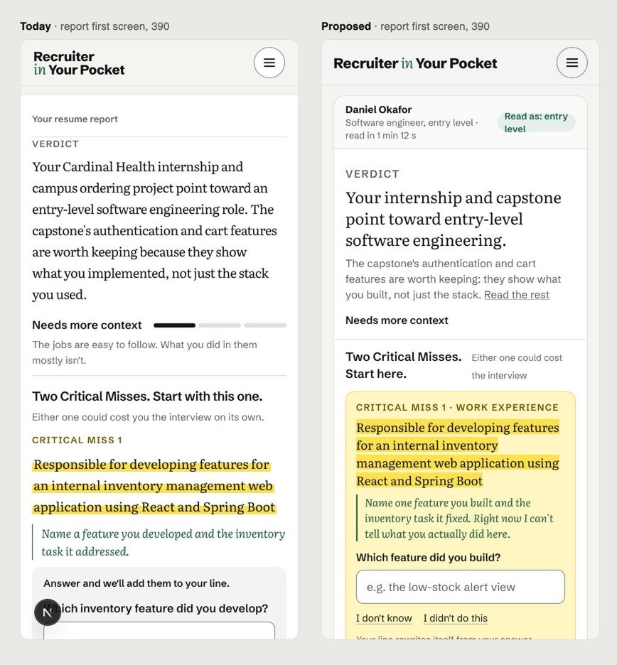
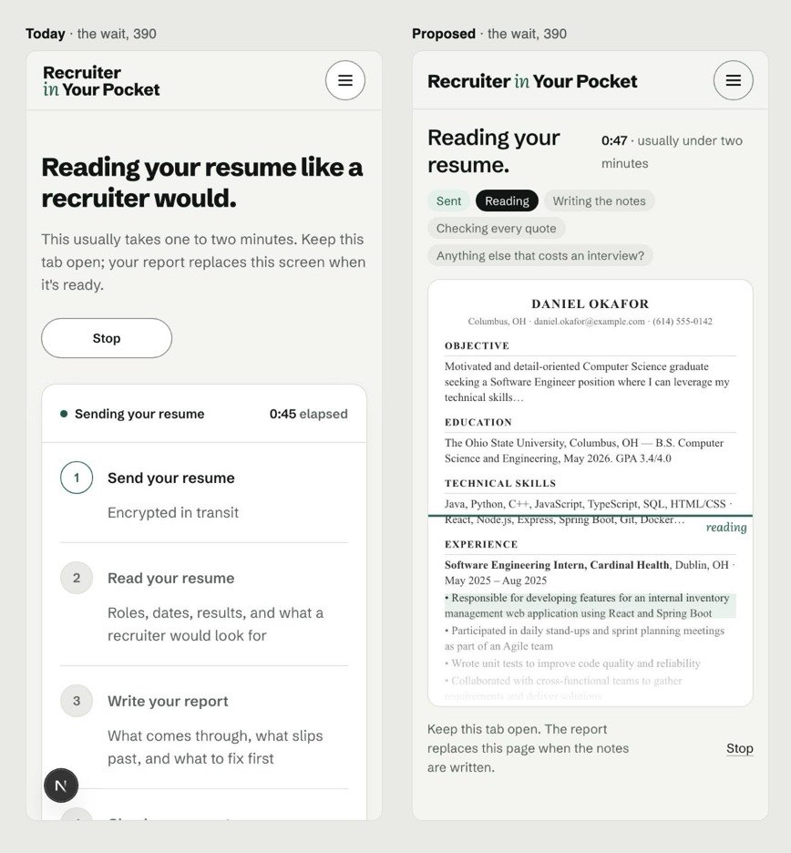
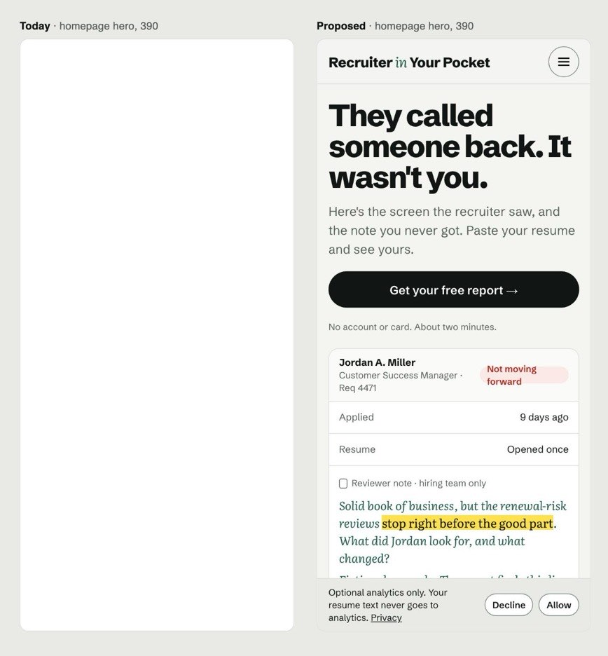

# The bar: what Recruiter in Your Pocket should become next

Date: November 2, 2026. Branch `claude/bar-2026-11`, cut from origin/main `3bfd639a`. Written as RIYP's founding product designer and engineer, with no product code changed. Companion: [docs/product/brief.md](../product/brief.md).

## The five-minute version

**Where it stands.** The product is better than its numbers. The homepage, the research library, the voice, and the Highlighter system are the work of people who care, and the November audits confirm it: one accessibility violation in sixty scans, color spent only on meaning, copy no competitor could reuse. But almost nobody has used it. Sentry's thirty days hold about ninety real-browser visits, half of them the founder's, zero purchases since July, and launch counters that read zero in production. The real test is still ahead, and this document is about winning it in the first five minutes after someone pastes a resume on a phone.

**What I found when I walked it as four people.** The report itself is the strength: Daniel's worst line was found and named, James's real numbers were quoted back to him, and the question flow turns a judgment into something you can act on. The failures sit around that moment, not inside it:

1. The wait starts under the sticky header on a phone and can sit on "Sending your resume" for a minute with nothing capping it; the longest, quietest stage ("Checking every quote") hides the second model call entirely.
2. The honest answer can be refused. Daniel answered three questions truthfully and got "This changes a detail from your resume" with no word named and Copy locked.
3. The product forgets you. A returning visitor, signed in or not, is told "Your first report is free" because the workspace assumes so until a status call answers; the free report is already spent.
4. The free report ends with a $29 button and no way to keep what you made: no PDF, no saved revised line, and "Save report" is a small text link out of view.
5. The consent card covers the one sentence that answers "what happens to my resume?" on every phone first screen.
6. For James, the layoff gap he came about was never mentioned where he could see it; for both James and Daniel, one question under a Critical Miss did not belong to its fix.
7. The paid loop works end to end in Stripe test mode: checkout, webhook, PDF, and a 39-second re-check that moved the Critical Miss. Around it: Stripe's form demands a street address for a digital pass, the pass card then reads "0 free reports left", and the comparison still says the old gap is "really closed".

**What I recommend building this wave** (section "This wave", mockups in 6a):

- **W1. One screen, one read.** The report's first 844 pixels on a phone: the Verdict's first sentence, the band, the count, and the first Critical Miss with its question field, all in view. Frontend only.
- **W2. The wait that reads your resume.** The person's own resume on the sheet, a pen cursor that moves only on real stream events, a fifth named stage for the severity check, elapsed time in the heading, and a latency bucket on the outcome counter so we finally know how long the wait is. Frontend plus a small engine contract.
- **W3. The answer you can keep.** A guard that names the word it objects to, never blocks pure additions, and a revised line that saves with the report and prints in the PDF. Frontend plus engine.

**What I recommend Matt decide** (section "Matt's call"): keep the Highlighter system and point it at "their screen"; make the PDF free for signed-in reports; test a free second read of the same resume within seven days; move the pass from 30 to 90 days at the same price; delete the extension, Jobs and LinkedIn code; collapse the trust pages to three; run five moderated sessions before the next wave; run one real production report this week to prove the counters flush; and soften "not an AI resume writer" to "we rewrite your line, only from your facts".

**What I recommend removing:** seven things, led by the three flagged-off Alpine-era surfaces, the research long tail, and the eight-page trust cluster.

**The engine, in one line:** about $0.02 a report, a 30-to-90-second model call nobody has measured in production, a 0.4-to-8-second synchronous validator that runs up to three times, a second model call that adds 4 to 25 seconds at the median and up to 40 at p90, and three dependencies that fail closed, one of them silently.

**The brand, in one line:** one voice and no face on every public page; the drift is inside the product after the paste, in the comparison copy, the PDF, a warning color that borrows the Critical Miss yellow, and one retired serif on the share card.

Everything below is the evidence, in the order the brief asked for.


## This wave: three bold moves inside the current system

Each is ready to build on origin/main with the Highlighter system as it stands. Mockups are static HTML renders built from Daniel's real report (see section 6a for the side-by-side images and what each move loses).

### W1. One screen, one read: the report's first 844 pixels



- **Person and moment:** Daniel on his phone, the first Critical Miss. Today the Verdict runs seven lines, the count heading competes with it, and the first question is below the fold. The moment the product is built for starts off-screen.
- **What changes:** a header row ("Daniel Okafor · Software engineer, entry level · read in 1 min 12 s" and "Read as: entry level" in pen tint) replaces "Your resume report"; the Verdict shows its first sentence in Literata and the rest in body text behind "Read the rest"; band name and bar share one row; the count is one row; the first Critical Miss sits on its miss sheet with the quoted line, the pen note, and the first question field. Save and Export move into the sticky tab row. Fix 2 and Fix 3 are labeled "Fix 2 of 3", "Fix 3 of 3" (Impeccable 4). The `ReportTOC` aria-label mismatch is fixed in the same change (Impeccable 2).
- **Risk:** the sentence split can land badly on a Verdict with an abbreviation or a number ("3.4 GPA."); use the existing report-sentences helper and fall back to the full Verdict when the first sentence is under 40 characters or the split is ambiguous. The "read as" line comes from `job_alignment.role_fit` and must never read as a prediction; if the field is empty, omit the chip.
- **Frontend or backend:** frontend only. Contract: none new. Uses `report.first_impression` (Verdict), `report.score` (band), `top_fixes[].critical` and `more_critical` (count), `job_alignment.role_fit` (read-as), and the existing `stage`/elapsed data for the read time. The PDF keeps today's order; only the web first screen changes.
- **Done when:** on 390×844 with the five longest saved outputs and the sample, the first question field is on screen without scrolling; axe passes at 320, 390 and 1440; the sample, fresh, recovered and saved routes all render the header row.

### W2. The wait that reads your resume



- **Person and moment:** everyone, 40 to 130 seconds, on a phone, half-expecting nothing. Today: a headline that scrolls under the header, a paragraph, Stop, then a checklist whose fourth step silently covers validation, the severity check and persistence.
- **What changes:** the heading row carries the elapsed time and "usually under two minutes"; a five-chip stage row (Sent, Reading, Writing the notes, Checking every quote, Anything else that costs an interview?); the person's own pasted resume rendered on the sheet in document type, dimmed, with a pen cursor and a tinted line that advance only on stage events; Stop becomes a quiet link; the slow-run aside keeps its copy but moves off the warning yellow. The heading-under-header bug (scrollIntoView under a sticky header) is fixed with `scroll-margin-top`.
- **Risk:** motion that implies progress the server has not reported. Rule: the cursor position is a function of the stage, never of elapsed time; reduced motion shows the static sheet; the "usually under two minutes" line is replaced by a measured number once W2's counter exists (see contract). Rendering the resume on the wait screen is in-memory only; nothing new is stored.
- **Frontend or backend:** both. Contract: (a) the server emits one new stage event `{ "type": "stage", "stage": "severity" }` from `severityCheckReport` before the second model call, added to `GenerationStage` in `web/lib/generation-stage.ts` (the client treats unknown stages as "checking", so the deploy order does not matter); (b) `riyp.report.outcome` gains a closed attribute `latency_bucket` with values `lt30`, `30to60`, `60to120`, `gt120`, computed in the route from `startedAt`; (c) the client renders `resumeText` from the already-held input state.
- **Done when:** the five chips flip on real events in a dev run with `forceGrounding`; the "severity" event appears in the stream contract test; `latency_bucket` shows up in Sentry within the hour of one production report; the headline is fully visible at 390 on arrival.

### W3. The answer you can keep: a guard that explains itself, and a line you can save

- **Person and moment:** the fifth minute. Daniel answered three questions truthfully and Copy stayed locked behind "This changes a detail from your resume. Edit it back to what's true to copy it." He has no idea which detail.
- **What changes:** (1) the guard names its objection in the person's words: "“web app” isn't in your line or your answers, but “web application” is. Use the words you wrote, or add it as an answer." for a token mismatch; "We can't tell which number goes with which claim in this line" for the relationship check, with "Use my exact words" offered as the fix; (2) when every added word traces to an answer, Copy is never blocked by the relationship check (the composition is already exempt; extend the exemption to edits that only reorder); (3) "Addressed" persists: for a signed-in report, the answers and the chosen line are saved with the report (`report_line_answers`), so the saved report and the PDF carry the revised line (today's PDF omits it); (4) the ending for a free, signed-in report leads with "Save this version" and the re-check as the second action; the $29 button stays on the pricing page and in the paywall.
- **Risk:** persisting answers is new personal data; it stays with the report, deletes with the account, and the privacy table gets one row. The guard copy must never suggest adding something that is not true; every message ends with the "if it's true" clause.
- **Frontend or backend:** both. Contract: (a) `checkPolishedLine` and `revisedLinePolicy` return `{ ok: false, reason: "new_fact" | "relationship" | "lost_answer" | "empty", tokens?: string[], nearest?: string[] }` instead of a boolean plus a generic message; the client maps reasons to copy; (b) `PATCH /api/reports/:id/answers` with `{ fix_index, answers: [{ question, kind: "open" | "unknown" | "not_mine", text? }], line, source: "literal" | "polished" | "edited" }`, 8 KB, owner-only, stored as JSON on the report row (migration 024), returned by `GET /api/reports/:id`; (c) `normalizeReportForPdf` reads the stored line into the Critical Miss row.
- **Done when:** the 13 saved outputs with realistic answers reach Copy in all 13 cases or show a reason that names a word; a saved report reopened on another device shows the revised line; the PDF prints it; `tests/revised-line.test.ts` covers the reasons.

Why these three and not the homepage: the homepage is already the strongest surface and is being worked on; the first five minutes are lost or won after the paste. W1 and W2 need no prompt change and no new data. W3 is the one that turns a judgment into a tool, which is the whole case for the second read.


## Matt's call

Each item has a recommendation and the smallest next step. Nothing here is started.

| # | Decision | Recommendation | Smallest next step |
| --- | --- | --- | --- |
| M1 | **Keep the Highlighter system or open a new direction?** | Keep it. Point it at "their screen" for the hero, the wait and the report's first screen (6a). No new type families, no new palette. | Approve W1 and W2 as the test of the direction; judge on the real screens, not the mockups. |
| M2 | **PDF free for signed-in reports (F1)** | Yes. The pass is for re-checks and job comparisons; the PDF is how the report reaches a coach, a friend, or a printer. | Flip the gate behind a flag; watch exports per finished report for four weeks. |
| M3 | **Second read of the same resume free within seven days (F2)** | Test it. It is the honest version of "Fix it. Then check it again." and the first real measurement of whether proof converts. | Build the similarity rule behind a flag; decide at 100 finished reports. |
| M4 | **Pass length: 30 days or 90?** | Change to 90 days at $29. A job search runs months; thirty days makes the fifth report a race. Cost per report is pennies. | One constant, pricing copy, terms line, and the Stripe product description. |
| M5 | **Delete the extension, Jobs and LinkedIn review from the codebase** | Yes. Tag the commit; they are not coming back in this shape. | One PR per surface; update privacy and trust tables. |
| M6 | **Collapse the trust cluster to Privacy, Terms, Help** | Yes (plan 4.9 agrees). | Redirects and one nav change. |
| M7 | **Merge the research long tail to eight articles** | Yes, after Search Console shows which pages get impressions (two weeks). | Wait for the data; pre-write the redirect list. |
| M8 | **The name "Critical Miss"** | Keep. It is the only coined term in the product and it earns its place. Retire "Recruiter First Impression" from the docs; the UI never says it. | Edit the brief and copy-system. |
| M9 | **Wordmark, palette, type** | No change. "Two Voices" and "The Noted R" are good; the share card needs to catch up (brand 4). | None beyond the brand fixes. |
| M10 | **Price** | Hold $29. There is no purchase data to move it on; F1 and F2 change what is free, which is the bigger lever. | Revisit at 100 finished reports or 5 purchases, whichever comes first. |
| M11 | **The consent card** | Shrink it to one line (6c.7). Essential storage needs no consent. | Legal check of the one-line wording, then ship. |
| M12 | **Moderated sessions (plan 6.2)** | Do five before the second wave, not after. This document walked the product as four fictional people; it is not evidence of what real ones do. | Recruit from the first ten finished reports with a one-line ask at the ending. |
| M13 | **Production counters** | Run one real report on production this week and confirm `riyp.report.outcome` arrives. Until it does, the monitoring doc is describing dashboards that read zero. | Fifteen minutes with the Sentry metrics explorer. |
| M14 | **Challenge to the brief: "not an AI resume writer"** | Soften it. The answer-to-revised-line flow is a writer that cannot invent. Say that: "We'll rewrite your line. Only from your facts." The refusal is to invention, not to help. | Approve the homepage and pricing wording in the brief. |
| M15 | **Challenge to the brief: anonymity** | Hold it, and let the sample report carry the trust it would have carried. One addition: a dated "How this report was checked" line under every Verdict (prompt id, validator, severity check) so the method is visible where the judgment is. | A one-line component fed by data the report already carries. |


## File-ownership map for two parallel builders

Two sessions, one branch each from origin/main, no shared files. Where a move needs both, the contract above is the handshake; the Engine side ships first because the Experience side treats a missing event or field as absent.

| Area | Experience owns (pages, components, CSS, copy) | Engine owns (API routes, server lib, schema, evals) |
| --- | --- | --- |
| W1 report first screen | `web/components/workspace/report/ReportStream.tsx`, `ReportStream.module.css`, `markup/MarkedRows.tsx`, `markup/ScoreBand.tsx`, `markup/MarkedReport.module.css`, `ReportTOC.tsx`, `ReportPanel.tsx`, `components/layout/ReportLayout.*`, `lib/reports/report-presentation.ts` (presentation only), `app/globals.css` (the `verdict-lead` role), `tailwind.config.js` | nothing |
| W2 the wait | `web/components/workspace/AnalysisScanning.tsx`, `AnalysisScanning.module.css`, `components/workspace/hooks/useResumeReview.ts` (stage handling only), `WorkspaceClient.tsx` (pass `resumeText` to the wait) | `web/lib/generation-stage.ts`, `app/api/resume-feedback-stream/route.ts` (emit `severity`, compute `latency_bucket`), `lib/reports/severity-check-report.ts`, `lib/observability/launchSignals.ts` (schema), `tests/stream-completion-contract.test.ts`, `tests/launch-signals.test.ts`, `docs/launch-readiness/monitoring.md` |
| W3 the answer | `web/components/workspace/report/markup/LineLift.tsx`, `LiftedTrace.module.css` (citron → pen), ending copy in `ReportStream.tsx`, `components/reports/ReportDetailClient.tsx` (load stored answers) | `web/lib/reports/revised-line.ts`, `revised-line-polish.ts`, `revised-line-polish-service.ts`, `app/api/revise-line/route.ts`, new `app/api/reports/[id]/answers/route.ts`, `web/database/migrations/024_report_line_answers.sql`, `lib/reports/pdf-export.ts`, `lib/backend/pdf.ts`, `tests/revised-line.test.ts`, `tests/pdf-export.test.ts` |
| Brand fixes (section 5) | `app/globals.css` (`--warning`), `components/workspace/report/ReadComparison.tsx`, `MissFeedback.tsx`, `FullRecruiterNotes.tsx`, `IndependentAdvice.tsx`, `UnlockBanner.tsx`, `app/og/home/route.tsx`, `public/fonts/*` (delete retired), `app/dashboard/ProgressView.tsx`, `components/reports/ReportHistoryList.tsx`, `app/layout.tsx` title, `lib/legal/dataHandling.ts` date, `docs/growth/brand-drafts.md` | `lib/backend/pdf.ts` strings, `app/api/passes/route.ts` and `app/api/export-pdf/route.ts` messages, `package.json` metadata |
| Design-system doc and guardrail | `docs/design-system.md` (§3 role, §4 warning, §7 shadows), `web/scripts/qa/design-system-guardrails.mjs`, `web/scripts/qa/design-system-budgets.mjs`, `tests/ui/accessibility.spec.ts` (320/390 axe) | nothing |
| Features F1–F4 (if approved) | pricing copy, ending copy, share card route `app/og/verdict/route.tsx`, reminder checkbox | `lib/billing/access.ts` (PDF gate), `generationAccess.ts` (second-read rule), `lib/auth/otpEmail.ts` sibling for the reminder, `app/api/checkout/route.ts` unchanged |
| Subtraction | navigation (`lib/navigation.ts`), trust routes, research redirects (`next.config.mjs` redirects are shared: Engine applies them, Experience supplies the list) | `extension/`, `app/api/extension/*`, `app/api/linkedin-feedback-stream`, `components/linkedin/*` deletion, legacy Stripe env and `stripeOffers.ts` |
| Shared, by agreement only | `web/app/globals.css` (Experience owns; Engine never touches), `lib/reports/report-presentation.ts` (Experience owns copy, Engine owns `readCriticalMisses` and count logic) | `web/lib/validation/resume-report-schema.ts`, `web/lib/llm/response-format.ts`, `web/prompts/*` (no change in this wave) |

Rules: prompts do not change in this wave. The Engine side runs `test:release-integrity` and `test:security`; the Experience side runs `qa:design-system`, lint, the UI specs for report navigation, mobile resume experience, first-report wait and accessibility, and looks at 320, 390, 1024 and 1440 before handoff.


## 1. Product brief

The one-page brief is its own file, so builders can read it without this document: [docs/product/brief.md](../product/brief.md). Two lines from it that everything below depends on: the job is "tell me why I'm not getting calls, and what to fix first, from someone on the other side of the table", and the proposed north star is one path counted per visitor: report finished → first Critical Miss answered → revised line used → second read.


## 2. Evidence: what real people are actually hitting

Sources: Sentry (org `recruiter-in-your-pocket`, read-only, pulled Nov 2), [the November Impeccable audit](../audits/2026-11-impeccable-audit.md), the open rows of [the remediation plan](../launch-readiness/70-audit-remediation-plan.md), [the November copy sweep](../copy-sweep-2026-11.md), and my own walk (section 3). The full Sentry pull with every query is in [appendix-sentry-evidence.md](2026-11-bar/appendix-sentry-evidence.md).

### 2.1 The honest baseline: almost nobody is here yet

- Sentry saw about 90 real-browser traces in 30 days once headless Chrome and curl are removed. 49 of those are geo-tagged to the founder's town. The organic footprint is a handful of phones: two Android devices in Beijing reading research and the sample, a Pixel 9 that opened the upload screen (5.9 s load) on Oct 29, and single visits from Singapore, Sao Paulo, Suwon, Frankfurt, Helsinki, London.
- The Oct 31 to Nov 2 traffic spike (1,240 / 4,070 / 1,359 transactions a day against 0 to 110 before) is launch-gate automation: 107 HeadlessChrome traces and 13 curl traces.
- No sampled real-browser pageload of `/reports` or `/pricing` exists. Zero purchases since the July 28 billing verification.

So the question "what are real people hitting" has a small answer today, and the plan in [first-100-users.md](../growth/first-100-users.md) is right that the next ten weeks are about getting 100 strangers to a finished report. Everything below is sized to that.

### 2.2 What did go wrong, in order of severity

| # | What | Evidence | Status |
| --- | --- | --- | --- |
| 1 | **Nine reports withheld by the evidence check** ("The report did not pass its evidence check"), Oct 30 to 31, in three tight bursts from one Chrome on macOS. The person waited the full generation and got nothing. | Sentry JAVASCRIPT-NEXTJS-14, release `e05da605`; `validateResumeStreamOutput.ts:133` | Validator fixes shipped Nov 1 (`9c4eaada`); no recurrence. The burst pattern reads as one person retrying. |
| 2 | **A silent 500 on upload parsing.** Nov 1, 15:12 UTC, a real Chrome session loaded `/workspace` and `POST /api/parse-resume` returned 500. No Sentry error was captured for it. | Trace `bb7156f41c6b4cb8803013c5a5a3bdeb` | Parse failures now return 422 (plan 0.11), but a genuine 500 here still raises no issue. |
| 3 | **The launch counters are not live in production.** `riyp.report.outcome`, `riyp.severity.outcome`, `riyp.free_gate.check`, `riyp.checkout.step` exist only as a seven-sample smoke test tagged `monitoring-verification`. Sentry Logs: zero lines in 90 days. Replays: none. | Metrics queries in the appendix | The dashboards in [monitoring.md](../launch-readiness/monitoring.md) are reading zeros. Either no report has run on `568b923a`+ in production, or the counters are not flushing. This needs one real production report and a look at the metric within the hour. |
| 4 | **The report route has no performance data.** 10 percent trace sampling plus low volume: nine errors on `/api/resume-feedback-stream` and zero sampled transactions. p50 and p95 of the wait cannot be read from Sentry, and nothing in the repo records main-call latency durably. | Appendix section 5; [appendix-engine-diagnosis.md](2026-11-bar/appendix-engine-diagnosis.md) 2.1 | The wait screen promises "one to two minutes" on a code comment about a 117-second September outlier. |
| 5 | **Research articles are slow on real phones and laptops.** LCP p75 of 13.3 s on `/research/quantifying-impact` (2 samples) and 18.2 s on `/research/how-recruiters-read` (1 sample), while `/` is 622 ms. INP p75 on `/workspace` is 448 ms, the worst page, and one real session fired the INP alert at 1,616 ms. | Web vitals in the appendix; Impeccable item 9 | Tracked as plan 3.15. These are the pages the search channel lands people on. |
| 6 | **Deployment skew noise.** "Failed to find Server Action", six events in 34 seconds from one Safari tab after a deploy. | JAVASCRIPT-NEXTJS-13 | Not a product bug. Harmless, but it is one of only three issues in the project, so it muddies the view. |

### 2.3 What the audits still have open

From the remediation plan (gate C = before charging):

- **0.1 / 6.1** Matt's real purchase and refund on production have not happened. Checkout reaches live Stripe since Nov 1; the loop has not been closed by a human.
- **1.3** The Critical Miss prompt is still `83b2a2d1`; the severity check adds up to two more Critical Misses after validation. Matt's blind-pick bar (80 percent preference) was never passed by a prompt change; the severity check passed its count gates instead.
- **1.10** Four validator false-rejection classes are still open (back-referring summary sentences, "practice areas", count paraphrases, outcome-presupposing questions).
- **2.3** The paid re-check loop exists but the "addressed" state is local only; nothing persists the answer.
- **2.6** In-product feedback shipped ("Was this the right thing to fix first?"); migration 023 (retention) still needs Matt's OK in production.
- **3.13, 3.15** Dark mode is documented and forced off; page weight on text routes is 466 to 638 KB of JS.
- **4.6** The wait screen now shows real stages, but the fifth stage (the severity check) is invisible: the person sits on "Checking every quote" for the severity call and persistence.
- **6.2** No moderated sessions with job seekers have been run. Nothing in this document replaces that.

From the Impeccable audit, unaddressed on origin/main as of Nov 2: the `ReportTOC` Label-in-Name failure below 640 px (item 2), the consent card covering 22 percent of the phone's first screen (item 3), "Fix 2" and "Fix 3" with no visible Fix 1 on phones (item 4), the pricing button emphasis flip (item 5), the browser-default focus ring on header links (item 6), the unlabeled "I don't know" / "I didn't do this" pairs (item 7), and the homepage quoting a sentence the sample report hides (item 8). Items 1 (band language) and parts of 15 were fixed by the copy sweep.

From the copy sweep: the public pages landed; every report-component proposal (the comparison copy, "the read" phrasing, the PDF's retired names, the empty panel's text arrow) was routed elsewhere and is still live. The brand audit in section 5 re-checked each one in code.

### 2.4 What my walk added (details in section 3)

- The workspace assumes a free report is available until the status call answers (`useState(1)`). When that call is slow or fails, a returning signed-in person who has used their report is told "Your first report is free", pastes, waits, and meets the paywall. Production `/api/free-status` p95 is 918 ms with a 1.2 s max in the sample, and it depends on Redis.
- The honest answer flow can refuse to let you copy your own facts. Daniel answered three questions truthfully and got "This changes a detail from your resume. Edit it back to what's true to copy it." with no pointer to which detail. The guard is right to exist; the message is not.
- On a phone the wait screen's heading scrolls under the sticky header on arrival, so the first thing in view is a cut-off headline and a Stop button.
- The sign-in flow's code step auto-submits and does nothing visible for several seconds while the next route compiles or loads; on production that gap is shorter but the screen still has no "verifying" state beyond the button label.
- Anonymous reports need both a proxy IP header and Redis. Locally there is no path to run the real engine anonymously, which is why every mock-based test skips the grounding validator and the real wait.


## 3. Walk it as them

### How this was done, and what it can and cannot say

- **Where:** a fresh worktree at origin/main `3bfd639a`, run locally against the rehearsal Supabase project (`magrywxeunjinvlqsvct`, never production), Stripe test mode with the Stripe CLI forwarding webhooks, Resend's `delivered@resend.dev` test inboxes (plus-addressed per persona) for sign-in codes, and the real model, `gpt-6.1-terra`, for every signed-in report. Four fictional resumes, written for this walk: [Daniel](2026-11-bar/resumes/1-new-grad-daniel.txt), [Maria](2026-11-bar/resumes/2-career-changer-maria.txt), [James](2026-11-bar/resumes/3-layoff-gap-james.txt), [Wei](2026-11-bar/resumes/4-senior-ic-wei.txt).
- **Two limits that matter.** First, the anonymous path needs a proxy IP header and Redis; neither exists locally, so the signed-in journeys ran on `next dev` with the real model, and the anonymous first-visit flow ran separately with the mock model. Wait times below include dev-server compile time and are **not** production numbers; the shape of the wait (which stage, how long it sits silent) is real. Second, every screenshot was taken by a script at 390×844 and 1440×900 with a 2x pixel ratio; the Next dev badge in the corner of some phone screenshots is the dev server, not the product.
- **Public pages** (homepage, pricing, sample, research, methodology, sign-in, FAQ, 404, upload screen) were captured from a production build at both widths: [`2026-11-bar/public/`](2026-11-bar/public/).
- **The think-alouds are mine, in each person's voice.** They are informed guesses, not research. Plan item 6.2 (moderated sessions) is still the thing that would make them evidence.

Ranking rule for the problems: impact on the first five minutes, for a person on a phone who has not decided to trust us yet. A problem at the paste or the first Critical Miss outranks anything on pricing.


### 3.0 The anonymous first visit (mock model, phone and desktop)

Screens: [`2026-11-bar/anon/`](2026-11-bar/anon/). Entry on the homepage, "Get your free report" in the header, paste, run, report, answer, then a second attempt and a return.

| Step | What they see | Think-aloud | Where they'd leave |
| --- | --- | --- | --- |
| Homepage, phone | Headline, subhead, action, "Your first report is free. No account or card.", then the resume illustration half under the consent card | "Okay, 'it wasn't you', that's a bit much, but fine. Free, no account. What's that card? Decline." | If the consent card hides the resume and they don't scroll. |
| Upload screen | "Let's see what they see." A dashed box, "Choose a file", "Paste the text instead", a greyed "Choose a resume to begin", the privacy line under it, the consent card again on top | "Where does my resume go? Oh, there it is, under the button, under the privacy card." | Right here, if the privacy line is covered. It was, on every phone screenshot until the card was declined. |
| Paste | The textarea, "Formatting can be rough. We only need the words." The button turns ink: "Get your free report" | "Good. It didn't ask me for an email first." | Nowhere. This step is right. |
| The wait | The heading sits under the sticky header ("…esume like a recruiter would."); "This usually takes one to two minutes"; Stop; "Sending your resume 0:02 elapsed"; four steps | "Sending… still sending at 0:45. Is it stuck? Should I press Stop?" | Between 30 and 60 seconds, if "Sending" is still the label. On the dev server it was; in production the server's first stage event should arrive within a second or two, but nothing on the client caps "Sending" if it doesn't. |
| Report | "VERDICT", two sentences in Literata, the band, "One Critical Miss. Fix it first.", the highlighted line, a pen note, a question field | "That's… actually about my resume. The yellow line is mine." | Nowhere, if the line is specific. The mock's line was generic; the real ones below were not. |
| Answer | Type an answer, the revised line appears with the answer underlined in blue, "Addressed" | "It just added what I typed. Fine. Can I copy it? Yes." | Nowhere. |
| Second attempt, phone | A fresh workspace with "Open your last report", paste, run, the wait screen appears, five seconds later a modal: "Your free report needs an account. The free report on this device or network has been used." Sign in, or $29 | "Why did it start reading it, then stop? I'd have signed in before pasting if you'd said." | Here. The gate fires after the paste and after the wait screen, not before. |
| Return, same browser | The workspace again. "Your first report is free." No link to the last report on this view (it appears only with `?new=1`). My reports: a sign-in page. | "I thought I already used it? And where did my report go?" | Here, on a phone, a week later. |

Three things from this flow go on the ranked list: the consent card over the privacy line, the gate that fires after the wait, and the returning visit that forgets.

One result I cannot explain and did not count: on the desktop run, the second anonymous attempt produced a second report instead of the paywall. The in-memory local ledger resets when the dev server recompiles, so this is most likely a dev artifact; it should be re-checked on a build with Redis before anyone treats it as a bug or a non-bug.

### 3.1 Daniel, new grad, on a phone (real model)

Entry: the homepage. Resume pasted. Screens: [`2026-11-bar/daniel/`](2026-11-bar/daniel/).

| Step | What he sees | Think-aloud | Where he'd leave |
| --- | --- | --- | --- |
| First screen | The hero. Three lines of 44 px headline, the subhead, the free button. | "Sixty applications, two replies. Yeah." | Not here. |
| Sign in | "Pick up where you left off", email, "Send sign-in code". Then "Check your inbox", an 8-digit field, auto-submit, "Verifying code…" for several seconds, then a first-name step. | "A code, fine. Why do you want my first name? Skip." | The verifying gap. On the dev server it was 10 to 20 s with no change on screen; on production it will be shorter, but there is still no sentence under the spinner. |
| Paste | Upload box first, "Paste the text instead" as a link. Tap, paste, the button lights up. "Your first report is free." | "It says it won't store my resume. Okay." | Not here. The privacy line is in view once the consent card is gone. |
| The wait | 133 s on the dev server: "Sending your resume" for 54 s, "Reading" 5 s, "Writing" 25 s, "Checking every quote" 49 s. | "Sending for almost a minute. My wifi's fine. … Oh, now it's reading. Now it's 'checking every quote', for a long time." | At 0:45 on "Sending". The first stage label needs a ceiling. |
| Report, first screen | Verdict in seven lines of Literata: his internship and capstone "point toward an entry-level software engineering role", the capstone features "are worth keeping because they show what you implemented, not just the stack you used." Band: Needs more context. "Two Critical Misses. Start with this one." The highlighted line: "Responsible for developing features for an internal inventory management web application using React and Spring Boot". Pen note: "Name a feature you developed and the inventory task it addressed." | "That's my worst line and it knew it. 'Not just the stack you used' is exactly what my friend said." | Not here. This is the product working. The Verdict is long for a phone, but it is about him. |
| The questions | Three: "Which inventory feature did you develop?", "What task did it help users perform?", "Which roles helped define an inventory application requirement?" | "The first two I can answer. The third one is weird. Who writes 'which roles helped define a requirement'?" | He skips the third. The third question came from the generic ideas list, not from the Critical Miss. |
| The revised line | He answers all three. The line builds: "Responsible for developing features… : 3 features used by about 40 warehouse staff; manual stock checks went from daily to weekly; the inventory web app…" Under it: "This changes a detail from your resume. Edit it back to what's true to copy it." Copy is disabled. | "What did I change? I didn't change anything, I added. Which word?" | **Here.** The guard blocked true answers without naming the problem. He will not debug a sentence on a phone. |
| Critical Miss 2 | "Software Engineering Intern, Cardinal Health, Dublin, OH" highlighted; "add the size of the engineering team you worked on, if you can verify it." One open question. | "Okay, that one's fair. Eight people." | Not here. |
| The ending | "Revised it? See what changed." Then "Everything in your free report is yours. Nothing is held back." and the $29 button. | "I haven't revised anything yet. I need to go edit my resume first. Where's the save?" | He closes the tab meaning to come back. "Save report" is a small text button in the toolbar at the top, out of view. |
| Pricing | "Your first report is free. Five more are $29." Two full-width pills, the free one filled, the $29 one outlined, then the opposite emphasis in the cards. | "Five more? I have one resume." | Not a leaving point, but not a buying one either. The pass is framed for a person with several resumes or several jobs; Daniel has one and wants to re-check it. |
| Return, next day | The workspace again, "Your first report is free", no mention of yesterday's report. His free report is already consumed in the database. | "Did it not save? Or is it going to let me run it again?" | Here, if he pastes, waits, and gets the paywall. |

What worked: the Verdict and the first Critical Miss were specific to his resume and true. The question flow is the right idea. What failed: the guard's refusal, the ending that assumes he has already revised, and the return that forgets him.


### 3.2 Maria, career changer, on desktop (real model, DOCX upload)

Entry: the homepage (her original entry, a research article about gaps and pivots, could not be timed reliably on the dev server; its production capture is in [`public/research_how-recruiters-read@390.jpg`](2026-11-bar/public/research_how-recruiters-read@390.jpg) as the stand-in for "arriving from an article"). Resume uploaded as a Word file. Screens: [`2026-11-bar/maria/`](2026-11-bar/maria/).

| Step | What she sees | Think-aloud | Where she'd leave |
| --- | --- | --- | --- |
| Research article as a first screen (production capture) | The question as the headline ("Do recruiters only spend six seconds on a resume?"), the answer in Literata, the consent card over it, a figure, "What this means for your resume", then a bridge to the report. | "Oh good, someone actually read the study. Where's the thing that reads mine?" | Not here. The answer-first article is the right shape; the bridge sits mid-page, where she is still reading. |
| Sign in | Email, code, first name. On an earlier run the email she typed was wiped when the page finished loading and the form went back to empty (plan 4.14, reproduced). | "Did I not type it?" | Here, if it happens once. She types it again; a less patient person closes the tab. |
| Upload | "Drop your resume here. PDF or DOCX · 4 MB max." She drops the Word file. A toast: "Reading your resume file…"; the run button reads "Reading your resume…" while it parses, then the extracted text appears under "What we read". | "It read my Word file. The text looks right." | Not here. The parse-then-preview step is exactly what a nervous uploader needs. |
| The wait | 114 s on the dev server; "Sending" 32 s, "Reading" 9 s, "Writing" 21 s, "Checking" 52 s. | "Checking every quote for almost a minute. Checking what?" | At the long silent tail, same as everyone. |
| Report, first screen | Verdict: "Your move from mathematics teaching into analytics is clear from the certificate, bootcamp, and dashboard work. The projects name relevant tools, though the analysis itself gets less attention." Band: Mostly clear. "One Critical Miss. Fix it first." Highlighted: "Presented findings to a panel of instructors and peers" (the capstone). Note: "In the housing capstone, add one finding from the affordability analysis and identify the comparison behind it." Reason: "A finding would show what you learned from the housing and income data, beyond the tools you used." | "That's the line my coach flagged too. I listed the tools and never said what I found." | Not here. For a career changer the Critical Miss landed on the right thing: the proof that she can do the new job, not the old one. |
| The questions | Two, and both belong to the fix: "What affordability finding from the housing capstone would you highlight?" and "Which comparison led you to it?" | "I can answer both." | — |
| Keep this one | "The housing capstone names Python, SQL, Tableau, 10 years of data, and zip-code trends, giving the project a concrete technical foundation." | "Okay, so keep the tools, add the finding." | — |
| Fix 3 | The student dashboard line: "add an example of a unit identified for re-teaching and what the dashboard showed." | "That's a good one too." | — |
| Progress, later | "What keeps coming up": three red-pen notes, including "The summary states 8 years of experience while the teaching history also lists a role before August 2018, making it unclear what the count covers." "What keeps working": three green. "First Impression score over time: 74." | "Eight years, ten years, it caught that. But what's a First Impression score? The report never said that." | Not leaving. The page is useful; its title uses a retired name and shows a number the report withheld. |

What worked: the upload and preview, the best-matched question pair of the four runs, and a Progress page that catches an inconsistency the report itself did not lead with. What failed: the sign-in wipe, the silent "Checking" minute, and the naming drift on Progress.


### 3.3 James, back after a layoff, on a phone (real model)

Entry: pricing (he came from a search for "resume review cost"). Resume pasted. Screens: [`2026-11-bar/james/`](2026-11-bar/james/).

| Step | What he sees | Think-aloud | Where he'd leave |
| --- | --- | --- | --- |
| Pricing as the first screen | "Your first report is free. Five more are $29." Free button filled. | "Free first. Fine, I'll try the free one." | Not here. The price page sells the free report well. |
| Sign in and paste | Same as Daniel. | "Another code. Okay." | — |
| The wait | 78 s on the dev server; "Sending" 34 s, "Reading" 6 s, "Writing" 26 s, "Checking" 11 s. | "A minute. I've waited six weeks for a reply; I can wait a minute." | — |
| Report, first screen | Verdict: "Your senior marketing role is easy to place: you managed four marketers and a $1.8M annual budget. The 35% year-over-year MQL increase is worth keeping prominent… Your current freelance work is less detailed." Band: Mostly clear. "Two Critical Misses. Start with this one." Critical Miss 1: "Launched ABM program targeting enterprise accounts". Critical Miss 2: the freelance line. | "It didn't say anything about the gap. Everyone says the gap is the problem." | Not leaving, but unconvinced. The report's read is defensible by Matt's own rule (a gap is critical only when there is no recent relevant work), and it even calls out the freelance line as thin. But James came for an answer about eighteen months, and the report never says the words "gap" or "since March 2025" where he can see them. No "Before the bullets" note appeared in his fix section; if the model noticed the eighteen months, it said so only inside the collapsed full notes, where he will not look. |
| Answer | One question: "What would you add to this line?" He types, the line builds, "Addressed" appears next to the label, Copy is enabled. | "That was easy. Too easy? It just took what I said." | Not here. This is the flow working as designed: his words, his line, no invention. |
| Critical Miss 2's question | "Which freelance assignment required a difficult tradeoff between strategy and execution support?" | "That's an interview question, not a resume question. The note said add the number of clients." | He skips it. The question does not match the fix it sits under. |
| Ending and pricing | "Revised it? See what changed." $29. | "If I pay, will it tell me about the gap?" | Undecided. Nothing on the page says what the second read would do differently. |

What worked: a Verdict that quotes his real numbers, the first Critical Miss, and the answer flow. What failed: the thing he came for was answered quietly, if at all, and the second Critical Miss's question didn't belong to its fix.


### 3.4 Wei, senior IC aiming at top tech, on desktop (real model, with a job posting)

Entry: the sample report. Resume pasted, a Staff Payments Platform posting added. Screens: [`2026-11-bar/wei/`](2026-11-bar/wei/).

| Step | What they see | Think-aloud | Where they'd leave |
| --- | --- | --- | --- |
| Sample report as the first screen | Jordan's report, marked up, with the tabs and "Save report". | "A customer success resume. Not my world, but I see what it does: it quotes the line and asks a question." | Not here. The sample is a good landing for a skeptic. |
| Paste, then the posting | "Compare with a job (optional)" opens into a second textarea. The run button stays "Get your free report". | "Good, it takes the posting. That's the only reason I'm here." | Not here. But the posting field is a disclosure under the resume; Wei found it because Wei was looking. |
| The wait | 102 s on the dev server; "Sending" 62 s, "Reading" 11 s, "Writing" 26 s, "Checking" 3 s. | "Sixty seconds of 'Sending'. On a wired desktop." | At 0:45, same as everyone. |
| Report, first screen | Verdict: "Your current role centers on the ledger and settlement platform. The elimination of a class of duplicate-charge incidents is worth keeping because it connects a technical change to a concrete payment problem." Band: Mostly clear. "One Critical Miss. Fix it first." Highlighted: "Led the redesign of the core ledger service". Note: "Add the payment volume or geographic reach you can verify, and name a key architecture tradeoff you addressed." Reason: "The job specifies a global ledger handling billions in annual volume, while the current bullet describes the technology change without its operating scale." | "That's exactly the comment I'd get from a Staff loop. It read the posting." | Not here. With a posting, the Critical Miss is the best in the four runs: specific, tied to the role, and about scale, which is the thing senior resumes hide. |
| Answer | One open question. Wei types a volume figure; the line builds; "Addressed"; Copy enabled. | "Fine. I'd have written it differently, but the fact is in." | Not here. |
| Fix 3 | "Partnered with product and finance on the roadmap for multi-currency settlement": "Describe a technical recommendation you contributed and the tradeoff it addressed." | "Fair." | — |
| Ending and pricing | $29 for five. | "I have three target companies. Five reads against five postings is actually the right shape for me." | Wei is the one person of the four for whom the pass as sold makes sense. |
| Return | Workspace: "Your first report is free." My reports: the saved report with "82/100"-style number and "Resume review" as its title. Saved report: a header row ("My reports", "Check a revision"), a blank band, then the report; the answer and revised line are gone ("Saved reports don't keep your resume, so the line is built on the part we quoted."). | "Where did my line go? I typed the volume in yesterday." | Here, if the plan was to come back and copy the line. |

One note on my own harness, not the product: Wei's answer lost its dollar figure because the shell that wrote the persona file expanded `$4` to nothing. The report's input stored exactly what was typed; the loss happened before the product. It is called out here so nobody reads "about B in annual payment volume" in the screenshots as a product bug.

What worked: the posting changed the read, and the Critical Miss was the strongest of the four. What failed: the same return problems as everyone else, and a saved-report page that opens on two header rows and a blank band before the Verdict.


### 3.5 Coming back, paying, and the PDF (James's second visit; Stripe test mode)

Screens: `james-41` to `james-82` in [`2026-11-bar/james/`](2026-11-bar/james/).

| Step | What he sees | Think-aloud | Where he'd leave |
| --- | --- | --- | --- |
| Sign in again, a week later | Same code flow. Lands on the workspace: "Your first report is free." | "I already did one. Is this a second free one?" | He might paste again. The database says his free report is used; the screen does not. |
| My reports | "Your saved reports. Every version you've run, read the way a recruiter reads it." One card: "82/100 · Nov 2, 2026 · Points toward Senior Marketing Manager · Resume review", with a preview that is his name and email. Open, Rename, delete. | "82 out of 100? It said 'Mostly clear' yesterday. And it's called 'Resume review'." | Not leaving, but the number the report never showed him is now the first thing on the card. |
| The saved report | A back row ("My reports", "Check a revision"), a blank band, "Your resume report", then the Verdict. The Critical Miss is there; his answer is not: "Your line shows up here as you answer." and "Saved reports don't keep your resume, so the line is built on the part we quoted." | "I answered this. Where's my line?" | Here, for the person who came back to copy it. |
| Export PDF | No export control on the saved report for a free account (the report toolbar's export needs a pass). | "There's no download?" | — |
| The ending | "Revised it? See what changed." and "Get 5 more reports · $29". | "Okay. Let's see what $29 does." | — |
| Stripe Checkout (sandbox) | "Recruiter in Your Pocket — Job Search Pass, $29.00. Five additional complete reports, valid for 30 days. One-time purchase; no automatic renewal." Link and Amazon Pay buttons first, then Card, Cash App Pay, Klarna. Card asks for number, expiry, CVC, cardholder name, country, **street address, city, state, ZIP**, with "Save my information with Link" pre-checked and a phone field. | "A street address for a PDF? And why is Link ticked?" | Here, on a phone, for a $29 digital good. Billing address collection should be off, Link should be opt-in, and the wallet row should not outrank the card. |
| Return | `/purchase/confirmed`: "Confirming with Stripe. Checking your purchase. Checking your payment…" then, when the webhook is slow, "Next step: Check again · Restore access · Billing settings". Revisited later without the session id: "Needs attention. Find your purchase. This link doesn't identify a purchase. Use Restore access with the email you entered at checkout." | "Did it go through? It took my card." | The page is honest and calm. On my run the webhook timed out while the dev server restarted, so he would have sat here; replaying the event granted the pass within a second. Production's webhook is faster, but the slow case is the one to design for, and this page already does. |
| Billing settings, with the pass | "Settings · 0 free reports left · delivered+james@resend.dev". Under Billing: "Your pass · Active · **0 free reports left** · Purchases are tied to…", then "Need more than you have left? Another Job Search Pass adds five reports for 30 days", then "Purchases: Job Search Pass · Nov 2, 2026 · 5 remaining · Expires on Dec 2, 2026 · Active". | "Zero left? It says five remaining two inches lower." | Here, into the support inbox. The pass card's headline reads the free-report counter, not the pass. |
| The saved report, with the pass | Export is now in the toolbar. One tap, a PDF downloads: the Verdict in Literata, the band, "Two Critical Misses. Start with this one.", each marked line with the pen note in the margin, "Keep this one", Fix 3, "Keep these. They're working." Page one is half blank after Critical Miss 1 because each row starts a new block. | "This is good. This is the thing I'd print." | Not here. The PDF is the report, faithfully, in two pages. |
| The ending, with the pass | The button is now "Compare my revision". | "Let's see if the new line changed anything." | — |
| Re-check | The workspace opens in revision mode ("Re-check"). He pastes the resume with the ABM line rewritten. 39 s later: "Your Critical Miss changed. Your report now leads with something new. Check that the old gap is really closed, then take on this one." Side by side: Last time 82/100, the ABM Critical Miss; Now 82/100, a new Critical Miss on the freelance line. Then the full new report. | "So the line I fixed is fixed, and now it's the freelance line. The score didn't move at all?" | Not leaving; this is the payoff. Two things dent it: "really closed" and "something new" are the banned claims from brand finding 2, and a 0-point change beside a changed Critical Miss reads as "nothing happened" when something did. |

The honest summary of the paid loop: checkout works and says the right things; the return page is well designed for the slow case; the PDF is faithful; the re-check does what the homepage promises and does it in under a minute. Three things to fix around it: Stripe's form asks for more than the product needs, the pass card reports the wrong counter, and the comparison copy still makes the two claims the brand rules out.


### 3.6 The problems, ranked by impact on the first five minutes

| Rank | Problem | Who hits it | Evidence | Fix lives in |
| --- | --- | --- | --- | --- |
| 1 | **The honest answer can be refused.** Pure additions from the answer fields can trip the relationship check; the message names no word; Copy stays locked. | Daniel (blocked); James (passed). Any person whose answer repeats a word from their line with a different form. | `daniel-23-feedback-sent@390.jpg`; `revisedLinePolicy` in `lib/reports/revised-line.ts` | W3 |
| 2 | **The wait's first minute is unlabeled or mislabeled.** The heading scrolls under the header; "Sending your resume" has no ceiling on the client; the fourth stage hides validation, the severity call and persistence. | Everyone | `daniel-13-wait-45s@390.jpg`, `anon-04-wait-early@390.jpg`; engine map 4.1 | W2 |
| 3 | **The product forgets you.** `useState(1)` for free uses; no last-report link on a plain `/workspace` visit; "Save report" is a quiet text link out of the first screen; the ending assumes you already revised. | Every returning visitor; Daniel on day two | `daniel-28-return-workspace@390.jpg`, `anon-17-return-workspace@390.jpg`; `WorkspaceClient.tsx:76`; `user_usage.free_report_used_at` set in the DB while the UI said free | W3 (save), W1 (toolbar), plus a one-line fix: default `freeUsesRemaining` to unknown and hide the hint until it resolves |
| 4 | **The gate fires after the paste and after the wait screen.** The second anonymous attempt shows the wait for five seconds, then the paywall. | Anyone on a shared network or a second device, on their first attempt | `anon-14-second-attempt-result@390.jpg`, `anon-16-second-attempt-after@390.jpg`; monitoring.md §2 (`reason:network`) | Engine: check `free-status` before enabling the run button when the cookie says used; Experience: say "Sign in for your free report" on the button itself |
| 5 | **The consent card covers the privacy line and the Critical Miss on phones.** 187 px of an 844 px screen, on every first visit. | Everyone on a phone | `public/workspace@390.jpg`, `daniel-19`…; Impeccable 3 | 6c.7, M11 |
| 6 | **A question that doesn't belong to its fix.** Daniel's third question and James's only question under Critical Miss 2 came from the report's general question list (`ideas.questions`), which the integrity pass moves onto any fix whose line they quote, whether or not they ask for the fix's missing detail. | Anyone whose Critical Miss line is also the subject of a general question | `james-report-text.json`; `report-integrity.ts:360-367` | Engine: only move a general question onto a fix when the fix's own `why` has no questions, and never ahead of them; otherwise show the single open question ("What would you add to this line?") |
| 7 | **The free report can't leave the browser.** No PDF without a pass; no share card; no email. | Daniel, Maria | 402 `PAID_ACCESS_REQUIRED` | F1, M2 |
| 8 | **The Verdict is too long for the first screen on a phone.** Seven lines of 20/30 Literata before the band. | Everyone on a phone | `daniel-19`, `james-19` | W1 |
| 9 | **The thing James came about is answered quietly.** No structural note in his fix section; the gap appears, if at all, in the collapsed notes. | James, and anyone with a dated break | `james-report-text.json`; plan 1.4 | Engine: when the model reports a structural gap, print it as the "Before the bullets" note above Critical Miss 1 even when it is not a Critical Miss (the component exists) |
| 10 | **Sign-in drops what you typed, then goes quiet.** On Maria's desktop run the email typed before hydration finished was wiped and the form reset to empty (plan 4.14, previously a single observation, now reproduced). After the code, auto-submit shows a spinner label and nothing else until the next route loads. | Everyone who signs in on a slow connection | `maria-04-error-state@1440.jpg`; `daniel-04`, `daniel-05` | Experience: disable the field until hydrated or preserve typed input across it; one sentence under the code field; make the first-name step optional and after the report |
| 11 | **"Overview" as a tab name, and the sample's "Fix 2", "Fix 3" with no visible Fix 1 on phones.** With the count shipped, a real report reads "Critical Miss 1, Critical Miss 2, Fix 3", which is fine; the sample still shows the old labels. | Phones | Impeccable 4; `daniel-20-report-full@390.jpg` | W1 |
| 12 | **Pricing flips emphasis and sells five reports to a person with one resume.** | Daniel | `daniel-26-pricing-first-screen@390.jpg`; Impeccable 5 | F2, M3, M4; Experience for the emphasis |
| 13 | **Checkout asks for a street address and pre-checks Link.** Stripe's hosted form collects full billing address for a $29 digital pass, shows wallet buttons above the card option, and ships with "Save my information with Link" on. | Every buyer, worst on a phone | `james-55-stripe-checkout-full@390.jpg`, `james-62-checkout-return@390.jpg` | Engine: `app/api/checkout/route.ts:285` sets `billing_address_collection: "required"`; change it to `"auto"`, turn Link off by default, and check the Stripe dashboard payment-method order |
| 14 | **The pass card says "0 free reports left" on an active pass.** Settings and the Billing tab headline the free counter while the purchase row below says "5 remaining". | Every buyer, right after paying | `james-73-billing-with-pass@390.jpg`; `components/workspace/SettingsClient.tsx` pass card | Experience: the pass card reads `uses_remaining` from the pass; the header chip says "5 reports left on your pass" (copy-system §1) |

Not on the list because they did not reproduce or are environmental: the anonymous desktop second report (dev ledger artifact, re-check with Redis), dev-mode compile time inside the wait, and the "Failed to refresh free status" console errors (no Redis locally).


## 4. Engine diagnosis

The full map with file and line references, the stage table, thirty-plus failure modes with their exact user-facing copy, and the cost arithmetic are in [appendix-engine-diagnosis.md](2026-11-bar/appendix-engine-diagnosis.md). This section is the version a builder needs in their head.

### 4.1 The pipeline

```
browser ──POST /api/resume-feedback-stream──▶ route.ts
  │ rate limit (Redis, in-memory fallback in dev; fails closed in prod without Redis)
  │ validate request (200..30,000 chars; JD ≤ 8,000)
  │ anonymous: cookie identity + x-forwarded-for "shadow" hash ──▶ Redis ledger (1 free / month / identity and network)
  │ signed in: Supabase RPC reserve_generation_access / begin_generation_operation
  │ daily cap (Redis Lua; unconfigured or Redis-down ⇒ every report refused)
  ├─ stage: reading ──▶ gpt-6.1-terra, resume_v2 (83b2a2d1), strict JSON schema, 90 s, streaming
  │     (chunks are accumulated server-side only; nothing streams to the person)
  │     finish_reason ≠ stop ⇒ one retry at higher effort (stage: retrying)
  ├─ stage: checking ──▶ validateResumeStreamOutput: source contradictions, grounding, zod, calibration
  │     invalid ⇒ one non-streaming repair call (resume_v2_repair), re-validate
  │     ──▶ severityCheckReport: second model call (severity_check_v1), ≤2 added Critical Misses, 45 s + 5 s, never fatal
  │     ──▶ finalize: RPC finalize_generation_report (signed in) | Redis signed envelope, 24 h TTL (anonymous)
  └─ one `complete` NDJSON event (5–8 KB) ──▶ client zod ──▶ report
answer a Critical Miss: browser composes the literal line ──▶ POST /api/revise-line (polish, ≤10 s) ──▶ deterministic guard decides
PDF: POST /api/export-pdf (sign-in + pass) ──▶ Puppeteer / sparticuz chromium
```

Two things the diagram makes obvious. First, "streaming" is four stage flips and one payload; the person never sees a word being written. Second, three network dependencies sit between the paste and the model (Redis, Supabase, OpenAI), and two of them fail closed.

### 4.2 Timing, labeled

| Stage | Number | Source and label |
| --- | --- | --- |
| Route gates, prompt build, persistence prep | median 228 ms end to end with the model mocked | measured locally, mock provider, warm route |
| Main model call | unknown | no durable record exists; the eval runner writes `latency_ms` into gitignored files. Working range 30 to 90 s (estimate from the 90 s timeout and a code comment about a 117 s outlier) |
| Grounded validation | median 2.5 s, 0.4 to 8.0 s per report | measured on 13 saved production outputs on an Apple Silicon Mac; synchronous, blocks the event loop, so stage events cannot flush while it runs |
| Severity check (call + merge + re-validate) | p50 10.7 s, p90 24.9 s (fresh 52); p50 4.0 s, p90 40.3 s (golden 23) | eval-derived, Nov 2 summaries |
| Repair call, when it runs | unknown; at least another main call | estimate; evals show a repair or incomplete retry on 4 of 10 and 6 of 23 fixtures |
| Revised-line polish | median 2.5 s, p95 4.3 to 5.2 s | eval-derived, two live runs |
| My walk, dev server, Daniel's report | 133 s total: 54 s before the first server stage event (includes dev compile), 5 s "reading", 25 s "writing", 49 s "checking" (validation + severity + finalize) | measured once, dev mode, not representative of production |

The person's experience: the wait is one model call plus a long silent tail. "Checking every quote" covers validation, the severity call, and persistence, which is where the p90 lives.

### 4.3 Failure modes the person can meet (the short list)

| What breaks | What they see | Counted as | Recoverable |
| --- | --- | --- | --- |
| Free report already used on this browser or network | Paywall: "You've used your free report…" | `free_gate.check blocked` | Sign in or buy |
| A new visitor shares a network with a prior user (office, campus, carrier NAT) | The same paywall, on their first attempt | `blocked reason:network first_attempt:yes` | Sign in; this is the alert in monitoring.md §2 |
| Redis or Supabase unavailable | "Report access is temporarily unavailable. Please try again in a moment. This didn't use one of your reports." | `failure:access` | Retry |
| Daily cap unconfigured or Redis down on the cap path | "Report generation is temporarily unavailable. Please try again shortly." after the reservation was made and released | `failure:paused` (not alerted) | Retry; silent in monitoring |
| Model timeout at 90 s | "This is taking longer than usual. Try again in a moment." | `failure:timeout` | Manual retry; no transport retry on the streaming path |
| Model stops early (8,000-token cap) | Wait screen: "Starting the read again" | one automatic retry | then "The model stopped before the report was complete." |
| Output fails grounding, repair succeeds | Nothing; the wait grows by a full model call | `report.repair completed` | Automatic |
| Output fails grounding, repair fails | "We couldn't finish this report on our side. Your resume wasn't the problem." | `repair failed`, Sentry | Manual; this was the Oct 30–31 incident |
| Severity check times out or errors | Nothing; up to 50 s more on "Checking every quote" | `severity.outcome error` | Report ships with one Critical Miss |
| Signed-in finalize fails twice | "The report could not be finalized safely." | `failure:persistence` | The validated report is lost |
| Connection drops mid-wait | "The connection dropped before your report finished." then, on reload, "Your report may still be finishing…" | recovery poll | 24 h for anonymous (Redis only), replay for signed-in |
| Stop | "Report stopped. We gave that report back." | `canceled` | By design |
| Upload unreadable | "Could not read this file. Try uploading a new PDF or DOCX copy." | 422 | Paste instead |
| PDF without a pass | "PDF export is included with paid access." | 402 | Buy |

### 4.4 Cost per report

Prices in code (`web/lib/llm/cost.ts`, verified against the OpenAI model page on Oct 30): gpt-6.1-terra at $1.00 per million input tokens, $0.05 cached, $1.25 cache-write, $5.00 output.

| Scenario | Estimate |
| --- | --- |
| Main call, cold cache (about 9,000 in, 2,400 out, measured by evals) | about $0.023 |
| Main call, warm cache | about $0.014 |
| Severity check | $0.001 to $0.002 (eval-derived) |
| Repair, when it runs | about $0.027 extra |
| Revised-line polish | about $0.002 per polish |
| **Typical report** | **$0.015 to $0.03**, about $0.05 when a repair or retry runs; ceiling about $0.15 if every call hits the 8,000-token cap |

At $29 for five reports, the model cost of a fully used pass is under a dollar. Cost is not the constraint; latency and trust are.

### 4.5 Engine risks worth a builder's week

1. **The validator is the hidden latency.** 0.4 to 8 s per pass, run up to three times per report (validation, repair, severity merge), synchronously. Profiling `source-fidelity.ts` and `schemas.ts` and caching the per-resume line index between passes is the cheapest latency win that touches no prompt.
2. **No production latency measurement exists.** Add a bucketed `latency_ms` attribute to `riyp.report.outcome` (closed set: under 30 s, 30–60, 60–120, over 120). Zero cost; answers the "one to two minutes" question for good.
3. **The severity check is invisible on the wait screen.** Emit a fifth stage event and show it. Honest, cheap, and it explains the tail.
4. **Fail-closed paths without alerts.** The daily cap's `storage_unavailable` is counted as `paused`, which the failure alert ignores. A Redis outage on that path refuses every report silently.
5. **No `maxDuration` on any route.** Worst case is main 90 + retry 90 + repair 90 + severity 50 s plus validation. Confirm the Vercel Hobby function limit covers at least main + severity, or the function dies with the reservation open.
6. **The free report, the wedge, has the weakest durability.** Anonymous reports live only in Redis for 24 hours. Deliberate for privacy; worth saying out loud in the brief.
7. **Mock mode skips grounding.** Every local journey and CI UI run exercises a validator a thousand times faster than production's and one that never rejects. The Oct 30 incident class cannot be reproduced locally without `forceGrounding`.
8. **LinkedIn and the JSON route are a different, weaker engine** (json_object format, gpt-4o-mini default, no grounding, no repair, no severity, no counters). Do not turn LinkedIn on as-is.


## 5. Brand as a system

Every touchpoint was read against [voice-and-tone.md](../voice-and-tone.md), [copy-system.md](../copy-system.md), the Highlighter grammar in [design-system.md](../design-system.md), and the anonymity rule. The 30-row touchpoint table, 25 ranked findings with exact strings and `file:line`, and 41 lines worth protecting are in [appendix-brand-audit.md](2026-11-bar/appendix-brand-audit.md).

### 5.1 The verdict on the brand

The public site speaks in one voice and has no face. Homepage, pricing, research, the guides, legal, sign-in, the 404, the sign-in email and the generation-failure copy all read as the same insider, and nothing names the founder: JSON-LD is Organization-only, the sample JSON is clean, the portrait files are gone. The November sweep's public-page fixes landed. The strongest lines in the product ("They called someone back. It wasn't you.", "Blank on purpose. Jordan isn't real, and we don't make up answers for anyone.", "This didn't use your free report.", "Pop it in and you're back on the other side of the desk.") are as good as anything at the companies named in the bar.

Where it slips is inside the product, after the paste: the report components, the comparison, the PDF, and a handful of signed-in surfaces still carry the previous system's words and one of its colors.

### 5.2 Touchpoints at a glance

| Touchpoint | Voice | Naming | Highlighter grammar | Anonymity |
| --- | --- | --- | --- | --- |
| Homepage, header, footer, nav | pass | pass | pass | pass |
| Pricing, sample report, FAQ, trust, legal | pass | partial ("Reports" vs "My reports"; stale "Last updated September 4") | partial (status chips on warning yellow) | pass |
| Research index, articles, methodology, guides, calculator | pass | pass | pass | pass |
| Sign-in page and sign-in email | pass | pass | pass | pass |
| Report: Verdict, band, Critical Miss rows, answer flow | partial | pass | partial (citron on the trace) | pass |
| Report: re-check comparison | fail | fail | pass | pass |
| Report: full notes, other edits, feedback thanks | partial | fail | pass | pass |
| Report shell, wait, errors, pass banner | partial | partial | fail (warning yellow, sparkle) | pass |
| PDF | partial | fail | partial | pass |
| Share cards | pass | pass | fail (retired serif and a shadow on the home card) | pass |
| 404, error pages | pass | pass | pass | pass |
| Settings, My reports, Progress | pass | fail | pass | pass |
| Purchase confirmed and restore | pass | pass | partial (uppercase fallback, warning yellow) | pass |
| LinkedIn review (hidden) | fail | fail | fail | pass |
| Chrome extension and its store listing (hidden) | fail | fail | fail | pass |
| package.json | fail | fail | n/a | partial (`"author": "Matt"`) |
| LinkedIn Page drafts (brand-drafts.md) | pass | partial ("a score that says where to start") | n/a | pass |

### 5.3 The ten findings that matter most

1. **Operational warnings wear the Critical Miss yellow.** `--warning` aliases to the miss ink, so a slow-run notice, a failed save, status chips and purchase warnings all sit on the one color the system reserves for "what a recruiter would miss". Give `--warning` an ink-on-inset treatment.
2. **The re-check claims to know what a recruiter would miss** ("The revision didn't change what a recruiter would miss first") and says a changed miss is "closed". Both are banned claims. Say "Your revision didn't change the Critical Miss. Start there again."
3. **The report says the score weighs "how easy the page is to scan"; methodology says the report never sees the page.** One product, two stories.
4. **The homepage share card still loads Source Serif 4 and a drop shadow**, and four retired font folders ship in `public/fonts`. This is the first thing a shared link shows.
5. **The revised-line trace completes in Alpine citron**, the one off-palette color inside the signature flow.
6. **The PDF keeps "Suggested edits", "Revising your resume", "About draft templates" and a different AI disclosure than the FAQ.**
7. **Naming drift inside the account**: "First Impression score over time" on Progress, "Resume review" as a default title, "Get your first report" in the empty state, "paid access" in PDF errors, "Review the suggestions below." as a fallback heading, and three verbs for one action ("Check a revision", "Re-check", "Compare my revision").
8. **The pass-ready banner is a brass sheet with a decorative sparkle**, the last piece of "AI magic" in the product.
9. **Raw server strings reach the Settings toast** ("Failed to fetch passes", "Not authenticated").
10. **The LinkedIn Page copy sells "a score that says where to start" and "suggested edits"**, both retired by the band decision and the one-name table. Fix before the first post.

### 5.4 Anonymity check

Nothing public identifies the founder. Three internal leaks to close so they never become public: `package.json` (`"author": "Matt"`, "a high-end resume studio"), the internal launch pages (404 in production) and code comments, and the red-team fixture resume that starts with his name. Terms still says RIYP is "operated from Colorado"; that names no person and can stay.

### 5.5 Lines to protect

Quote these at anyone who proposes a rewrite: the full list is in the appendix. The short version: the hero and the silence section, "Blank on purpose", the worked example's note, "Let's see what they see." and "Formatting can be rough. We only need the words.", "One Critical Miss. Fix it first.", the band anchors, "Only what's true. Skip anything you don't know.", "Every word is from your resume or your answers.", the slow-run aside, the generation-failure copy, the sign-in email, the 404, "You're in. Five more reads.", "The questions you're asking at 1 a.m.", and "We'd rather print a small, honest number than a big, round one."


## 6. Beyond the current system

### 6a. Design system: keep Highlighter, change what it is pointed at

**The evidence does not support a new visual direction.** The November audit found one axe violation in 60 scans, no horizontal overflow from 320 px up, color used only for meaning, and a page that reads as "authored for this product, not interchangeable". My walk agrees: the type pairing is distinctive, the yellow is spent exactly once per screen, and nothing looks like a template. Replacing Schibsted Grotesk and Literata, the pen and the highlighter, or the paper-on-a-desk surface three days after they were applied to every surface would burn the one asset the product already has.

What the evidence does support is a change in **what the system is pointed at**. Today the Highlighter grammar is a document grammar: paper, pen notes, a highlighter. The homepage's strongest moment is not a document; it is the recruiter's screen with the stage and the note the candidate never saw. The product then never shows that screen again. The proposal is to make **"their screen"** the signature object of the three moments that decide the first five minutes, and keep the marked-up document for everything after.

| Screen | Today | Proposed | What it gains | What it costs | What it loses |
| --- | --- | --- | --- | --- | --- |
| Homepage hero, phone | Headline, subhead, action, then a resume illustration under a recruiter's card and a 187 px consent card; the note is blurred until scroll | Headline, one-line promise ("Here's the screen the recruiter saw, and the note you never got."), action, then the recruiter's screen full width: name, stage, one fact row, the note with one highlighted phrase, and the fictional tag. Consent becomes a one-line bar. | The note is in the first screen on a phone; the consent card stops covering the promise; one object carries the drama | A phone-specific composition for the hero (desktop keeps the resume behind the screen) | The tilted resume on phones. The worked example below still shows the line. |
| Report first screen | Eyebrow, a Verdict of up to four sentences in Literata 20/30 (seven lines on Daniel's phone), the band, the count, then the Critical Miss; the first question sits below the fold | The screen's header row (name, read as, read time), the Verdict's first sentence in Literata 22/30 with the rest in body text behind "Read the rest", the band name and bar on one row, the count on one row, and the Critical Miss on its miss sheet with the question field inside the first 844 px | The first question is on the first screen; the count stops competing with the Verdict; the yellow block is the obvious thing in three seconds | A sentence split rule for the Verdict (client-side; the prompt is untouched) and a header row component | Nothing the report says. "Your resume report / Save report" moves into the sticky tab row. |
| The wait | A headline that scrolls under the header on phones, a paragraph, a Stop button, then a four-step checklist with elapsed time; stage four covers validation, the severity check and persistence | The person's own resume on the sheet, dimmed, with a pen cursor and a tinted line that move only on real stream events; a five-chip stage row (Sent, Reading, Writing the notes, Checking every quote, Anything else that costs an interview?); elapsed time and "usually under two minutes" on the heading row; Stop as a quiet link | The wait looks like the promise (someone reading your actual page); the severity check gets a name; the first screen is the status, not an explanation | A fifth stage event from the server; a resume-sheet renderer that reuses the hero illustration's document styles; the sweep must stay honest (position changes only on stage events, never on a timer) | The explanatory paragraph. Reduced motion shows the static sheet with the chips. |

Side by side (today on the left, proposed on the right; proposals are static mockups built from Daniel's real report and resume). Two honesty notes on the mockups: the pen-note wording in the report mockup is illustrative and shorter than the model's actual note, which is what would ship (no prompt changes are proposed here); and the "read in 1 min 12 s" header line is the measured generation time on the dev server, shown only to make the point that the report can state it.




Desktop versions of the proposals: [hero](2026-11-bar/mockups/proposed-hero@1440.jpg), [report](2026-11-bar/mockups/proposed-report@1440.jpg), [wait](2026-11-bar/mockups/proposed-wait@1440.jpg).

Refinements to the system itself, all evidence-backed and cheap:

1. `--warning` gets its own non-yellow role (brand finding 1). Yellow means Critical Miss, nowhere else.
2. Retire `--citron` and `--accent-butter` (the trace), the Source Serif share card, the four retired font folders, and the pass banner's sparkle.
3. Add a `verdict-lead` type role (Literata 22/30 on phones, 28/38 from 768) for a single sentence, and keep `verdict` for the full read. The audit's 121-style problem was solved by eleven roles; this is the twelfth, with a reason.
4. Put the focus ring on header and footer links (Impeccable 6) and run axe at 320 and 390 in CI (Impeccable's one good recommendation).
5. Reconcile the shadow rule (design-system §4 says none, §7 allows subtle; the hero uses one).

### 6b. Product features: five changes to the offer

Each one names the person and moment, the evidence, what it replaces, the smallest test, the success signal, and the cost and risk.

#### F1. The free report ends in your hands: PDF and a shareable Verdict card for every signed-in report

- **Person and moment:** Daniel, five minutes in, with a revised line he likes and no way to take it anywhere; Maria, who wants to show it to her bootcamp career coach.
- **Evidence:** PDF export is pass-only (402 `PAID_ACCESS_REQUIRED`); the free report cannot leave the browser. The growth plan's partner channel depends on coaches seeing reports. Model cost per report is about $0.03; a PDF costs compute, not money.
- **Replaces:** "PDF exports for 30 days" as a paid feature. The pass keeps re-checks and job comparisons.
- **Smallest test:** signed-in reports get Export PDF; add a Verdict share card (band, count, no resume text) with an opt-in. Measure for four weeks.
- **How we know:** exports per finished report; sign-ups attributable to the export prompt; referrer traffic from shared cards. Target: sign-in rate after the free report rises from today's unknown to a measured baseline.
- **Cost and risk:** small (gate change, one card route). Risk: removes one bullet from the pass; the pass's real value is the re-check anyway.

#### F2. The second read of the same resume is free within seven days

- **Person and moment:** James, who answered the Critical Miss about his gap, rewrote the line, and is deciding whether $29 is worth it to find out if it worked.
- **Evidence:** the north-star path ends at "second read", and the pricing page's own argument is "Fix it. Then check it again." Today that proof is behind the paywall. No purchases since July; nothing suggests the paywall is where value is proven.
- **Replaces:** nothing is removed; the pass still covers job comparisons and reads of other resumes. The free tier becomes "one resume, two reads".
- **Smallest test:** when a signed-in account's second generation within seven days matches the first report's resume hash prefix (same name and first two roles), allow it free and show the comparison. Flag-gated.
- **How we know:** second-read rate among finished free reports; pass purchases per second read (does proof convert?). Decide at 100 finished reports.
- **Cost and risk:** one access rule plus the resume-similarity check; about $0.03 per extra report. Risk: cannibalizes the one paid use case that exists. That is the point of the test.

#### F3. "Paste the posting that ghosted you" as a first step

- **Person and moment:** James and Wei, who arrive from a specific rejection, not from "my resume in general".
- **Evidence:** the optional job posting already exists and changes the read ("How your experience fits this role"); the hero's whole story is one application that went silent. The upload screen hides the posting behind a disclosure.
- **Replaces:** the "Compare with a job (optional)" disclosure becomes a second, equal field with the hero's language: "The posting that went quiet (optional)".
- **Smallest test:** copy and layout only; measure the share of reports with a posting.
- **How we know:** posting-attached rate; Critical Miss feedback "right" rate with vs. without a posting.
- **Cost and risk:** trivial. Risk: longer first form on phones; keep it collapsed below 390 px but with the new label.

#### F4. Re-check reminder, once, by email, with consent

- **Person and moment:** anyone who finished a report and left; the "coming back" moment has no trigger today.
- **Evidence:** My reports and Progress exist but nothing brings a person back. Sentry shows no sampled `/reports` pageload at all.
- **Replaces:** nothing.
- **Smallest test:** one checkbox under the ending ("Remind me in a week to check the new version"), one email in the sign-in email's voice, one link to the re-check. Resend is already wired.
- **How we know:** reminder opt-in rate, click-through, second reads from the link.
- **Cost and risk:** small; needs the privacy page to list the reminder. Risk: low; it is opt-in and single-shot.

#### F5. The report's own feedback becomes the eval set, visibly

- **Person and moment:** Matt, every Monday; and the person who clicks "No" on "Was this the right thing to fix first?"
- **Evidence:** the feedback table exists (migration 022) and the judge gate exists, but nothing connects them. The honesty rule ("some resumes are truly horrible") was calibrated on ten resumes.
- **Replaces:** the mailto-era feedback path (already gone) and ad-hoc blind picks.
- **Smallest test:** a weekly read of `report_feedback` rows with the Critical Miss wording, joined to the saved report where it exists, into the judge's fixture format. No UI change.
- **How we know:** "wrong" rate per prompt version; whether the next prompt change moves it.
- **Cost and risk:** an engine script. Risk: none to customers.

Two things considered and not proposed: a chat with the recruiter (the brief's refusal holds; the report should speak first), and a price change (no data; see Matt's call).

### 6c. Subtraction: what to remove, merge, or hide

1. **Delete the Chrome extension, Jobs, and the LinkedIn review from the codebase** (keep a tag). All three are flagged off in production, all three are still Alpine (Instrument Sans, mono, teal, "Review my resume"), the LinkedIn route is a weaker engine with no grounding, and the Trust page had to be edited to stop mentioning them. They cost every audit, every guardrail run, and a page of the privacy policy. If job capture returns, it returns as "paste the posting" (F3).
2. **Merge the research library's long tail.** 23 articles plus 4 guides is more than the four pillars need, and the two slowest pages on the site are research articles. Keep the eight that answer a question people type (how recruiters read, quantifying impact, referrals, gaps and pivots, who you are, ATS myths, spelling, star method), fold the rest into those or into methodology, and redirect. Fewer pages, each faster, each linked from the report's "Why we read it this way".
3. **Collapse the trust cluster.** Privacy, Terms, Security, Trust, FAQ, Support, Status, plus `.well-known`: eight destinations for one question ("can I trust you with this file?"). Keep Privacy, Terms, and Help (FAQ + Support merged); fold Security and Trust into Privacy; take Status out of navigation (it is an operations view). Plan item 4.9 says the same.
4. **Hide the report's "Full recruiter notes" and "Other suggested edits" behind one disclosure, "Everything else we noticed", below the ending.** On a phone the report is a long scroll past the moment that matters; the section-by-section notes repeat observations the marked rows already made (Impeccable 15; copy-sweep's repeated-observation rule).
5. **Remove the section tabs on phones until the person scrolls past the Critical Miss**, which is already the rule, and remove "Overview" as a tab name everywhere else; the Verdict is the overview.
6. **Retire the legacy plans and prices from code** (lifetime, monthly, 24-hour): `STRIPE_PRICE_ID_LIFETIME`, `STRIPE_PRICE_ID_MONTHLY`, `STRIPE_PRICE_ID_24H`, the "Lifetime access" and "Monthly plan" labels, and `NEXT_PUBLIC_ENABLE_LIFETIME_PLAN`. One offer, one name.
7. **Drop the consent card's two-paragraph form.** Essential storage needs no consent; analytics is the only choice. One line, two buttons, bottom of the screen (mockup above). This alone gives the phone back 22 percent of its first screen.


## What this run changed, what was verified, and what is still uncertain

**Changed:** two documents (`docs/product/brief.md`, this file), the screenshot and mockup folders under `docs/design/2026-11-bar/`, three evidence appendices (engine, Sentry, brand), and the four fictional resumes. No product code, prompt, migration, or test was changed in this repository. The rehearsal Supabase project received migrations 022 and 023 (the report-feedback table and its retention job), which production already has (022) or is waiting on (023); the production project was not touched.

**Verified locally:** the production build of `3bfd639a` compiles; the public pages render at 390 and 1440 with no horizontal overflow; four real reports were generated with `gpt-6.1-terra` for signed-in fictional accounts on the rehearsal project (Daniel and James on a phone viewport, Maria and Wei on desktop, Wei with a job posting, Maria from a Word upload); the anonymous flow, the gate, and the return were exercised with the mock model; Stripe test-mode checkout, the webhook (after one replay), and the entitlement were exercised for James (see 3.5).

**Not verified, and said so where it matters:** production wait times (none exist anywhere; W2 adds the counter); whether the production counters flush (M13); the anonymous second-report anomaly on the desktop run; any real person's reaction (M12). The dev-server environment distorts timing and occasionally swallows a step; where a screenshot is missing from a persona folder, the log file beside it says why.

**Spend:** about fifteen model calls at roughly $0.02 to $0.05 each (reports, retries, severity checks and polishes), under one dollar in total, on the OpenAI key from the main checkout's root `.env`. No live Stripe key was used; no real charge was made.
