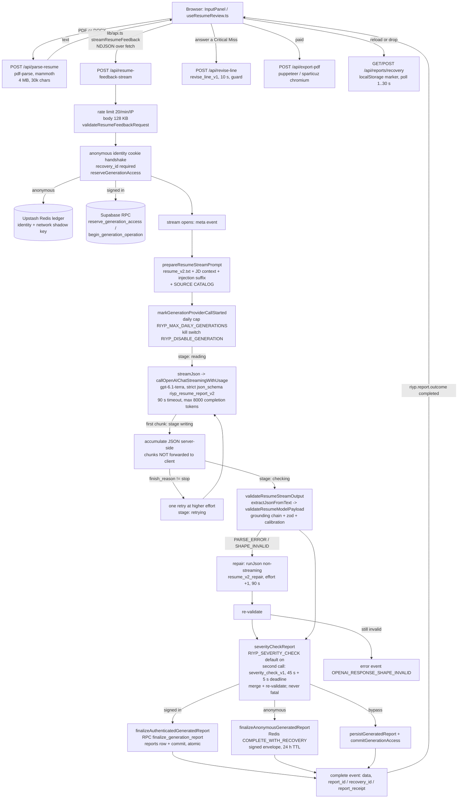

# RIYP report engine diagnosis

Worktree: `/Users/matsha05/Desktop/dev/riyp-bar-2026-11` (branch `claude/bar-2026-11`, commit `3bfd639a`, equals `origin/main`). Date: 2026-11-02. Read-and-measure only; no product code changed, nothing committed. No paid model calls were made (`USE_MOCK_OPENAI=1`, `RIYP_ALLOW_PAID_EVALS=false`, no Supabase, no Redis, no Stripe).

Every number below is labeled **measured** (run here), **eval-derived** (read from a stored eval artifact in the repo), or **estimate** (derived with a stated assumption). File paths are relative to the worktree; line numbers are from this commit.

---

## 1. Pipeline map

### 1.1 Diagram



ASCII view of the happy path inside the stream route (`web/app/api/resume-feedback-stream/route.ts`):

```
POST ─ L74 rateLimitAsync ─ L96 readJsonWithLimit ─ L113 validateResumeFeedbackRequest
    ─ L157-218 auth lookup, free cookie, recovery_id, reserveGenerationAccess
    ─ L311 recoveredReportId? -> single "complete" event (idempotent replay)
    ─ L357 ReadableStream.start
        ├ L366 {type:"meta"}
        ├ L379 prepareResumeStreamPrompt
        ├ L387 markGenerationProviderCallStarted (daily cap / kill switch)
        ├ L388 {stage:"reading"}
        ├ L390-430 for await streamJson ... first chunk -> {stage:"writing"}; INCOMPLETE -> {stage:"retrying"} once
        ├ L433 {stage:"checking"}
        ├ L434 validateResumeStreamOutput  (grounding, zod, repair)
        ├ L452 severityCheckReport         (second model call, merge, re-validate)
        ├ L462-497 finalize / persist / commit
        ├ L502 {type:"complete", data, report_id, report_receipt, recovery_id, free_*}
        └ L517 recordLaunchSignal riyp.report.outcome completed; close
      catch L532: release reservation, riyp.report.outcome failed, Sentry, {type:"error", message+disposition}
```

### 1.2 Stage table

| # | Stage | Entry file and function | Key dependencies | Notes |
|---|---|---|---|---|
| 0 | Upload parse | `web/app/api/parse-resume/route.ts` `POST` (L46) | `pdf-parse` (L109), `mammoth` (L116) | 30 req/min/IP (L54); 4 MB (L12); extracted text 50..30,000 chars (L138, L152) |
| 1 | Client request | `web/lib/api.ts` `streamResumeFeedback` (L100) | `attachAnonymousReportRecoveryMarker` (anonymous-report-recovery-client.ts), `parseResumeStreamCompletion` | Sends `{text, jobDescription, savedJobId, mode, recovery_id|operation_id}`; auto-retries once on `ANONYMOUS_IDENTITY_REQUIRED` (L162) |
| 2 | Route gates | `web/app/api/resume-feedback-stream/route.ts` L60-337 | `rateLimitAsync` (`web/lib/security/rateLimit.ts`, Redis with in-memory fallback), `validateResumeFeedbackRequest` (`web/lib/backend/validation.ts` L20: 200..30,000 chars, JD <= 8,000, mode must be `resume`), `requireAnonymousReportRecoveryId` (`web/lib/reports/anonymous-report-recovery-requirement.ts`) | Anonymous first visit answers 409 and sets `rip_anon_id`; the client retries transparently |
| 3 | Access reservation | `web/lib/billing/generationAccess.ts` `reserveGenerationAccess` (L142) | Anonymous: `web/lib/billing/anonymousGenerationAccess.ts` RESERVE_SCRIPT (identity hash + network "shadow" hash, 10-minute hold `HOLD_TTL_SECONDS`), `FREE_RUN_LIMIT = 1` (`freeCookie.ts` L5). Signed in: RPC `reserve_generation_access` or `begin_generation_operation` (migrations 012, 017, 019, 020, 021) | Reservation is not a use; commit happens only after validation. Signed-in retries with the same `operation_id` replay the committed report (route L311) |
| 4 | Prompt build | `web/lib/llm/resumeStreamPrompt.ts` `prepareResumeStreamPrompt` (L8) -> `web/lib/llm/resume-provider-messages.ts` `buildResumeProviderMessages` (L29) | `web/lib/backend/prompts.ts` `loadPromptForMode("resume")` -> `web/prompts/resume_v2.txt` (L7, L23); `sanitizeUserInput`, `wrapUserContent`, `INJECTION_RESISTANCE_SUFFIX` (`web/lib/security/inputSanitization.ts`); `buildResumeEvidenceCatalog` (`web/lib/llm/evidence-canonicalizer.ts`) | Messages: `[system JSON_INSTRUCTION, system resume_v2(+JOB_ALIGNMENT_CONTEXT)(+suffix), user <USER_RESUME> + SOURCE CATALOG (+JD block)]`. Prompt id `83b2a2d1` = SHA-256 of the trimmed `resume_v2.txt` (measured: raw file hashes `f7d30b1d`, trimmed `83b2a2d1`) |
| 5 | Model config | `web/lib/llm/model-config.ts` | `resolveOpenAIModel` (L75): resume, revise_line, severity_check -> `OPENAI_RESUME_MODEL` or `gpt-6.1-terra`; others -> `OPENAI_MODEL` or `gpt-4o-mini`. `resolveReasoningEffortForMode` (L84): `OPENAI_RESUME_REASONING_EFFORT` -> `OPENAI_REASONING_EFFORT` -> default `medium`. `PRODUCTION_OPENAI_MAX_COMPLETION_TOKENS = 8_000` (L29), `PRODUCTION_OPENAI_MAX_RETRIES = 1` (L30), verbosity `medium` | `.env.example` L39-42: `OPENAI_RESUME_MODEL=gpt-6.1-terra`, effort `medium`, `OPENAI_TIMEOUT_MS=90000` |
| 6 | Capacity | `generationAccess.ts` `markGenerationProviderCallStarted` (L480) -> `web/lib/operations/generationBudget.ts` `assertGenerationCapacity` (L126) | Redis Lua `DAILY_CAP_SCRIPT`; `RIYP_MAX_DAILY_GENERATIONS` (free) and `RIYP_MAX_DAILY_PAID_GENERATIONS` (paid, defaults to the free cap); `RIYP_DISABLE_GENERATION` kill switch | Skipped entirely when `USE_MOCK_OPENAI` (L484). In hosted production an unconfigured cap refuses every report (L95-101) |
| 7 | Generation | `web/lib/llm/orchestrator.ts` `streamJson` (L114) -> `web/lib/backend/openai.ts` `callOpenAIChatStreamingWithUsage` (L332) | Raw `fetch` to `https://api.openai.com/v1/chat/completions` with `stream: true`, `stream_options.include_usage`, `response_format` = `RESUME_REPORT_RESPONSE_FORMAT` (`web/lib/llm/response-format.ts` L237: `json_schema`, `name: riyp_resume_report_v2`, `strict: true`); abort scope `createOpenAIAbortScope` (`web/lib/backend/openai-transport.ts`) 90 s | No transport retry on the streaming path (retries live only in non-streaming `callOpenAIChat` L240). `finish_reason != "stop"` -> `OPENAI_RESPONSE_INCOMPLETE`; the route retries once with `increaseReasoningEffort` (route L389-430). Usage is captured for cost logs (`llm.run.completed`) |
| 8 | Validation | `web/lib/llm/validateResumeStreamOutput.ts` (L33) -> `web/lib/backend/validation.ts` `validateResumeModelPayload` (L139) | Order (L148-257): `positiveSourceContradictions` (`source-fidelity.ts`), `ambiguousReportSourceLocators` (`report-source-locators.ts`), `canonicalizeResumeReportEvidence` (`evidence-canonicalizer.ts`), `removeUnsafeRewrites`, required-field checks, zod `ResumeFeedbackResponseSchema` (`web/lib/validation/resume-report-schema.ts`), `assertReportGrounding` (`web/lib/validation/schemas.ts`), `calibrateResumeScore` (`resume-score-calibration.ts`), `ensureLayoutAndContentFields` | **Under `USE_MOCK_OPENAI` the whole grounding chain is skipped** (L148-149) unless `forceGrounding` is set. Production JD passes only `{ jobDescription }` (`effectiveJobDescription.ts` L34) |
| 9 | Repair | `validateResumeStreamOutput.ts` L82-141 -> `orchestrator.ts` `runJson` (L25) -> `openai.ts` `callOpenAIChat` (L202) with `buildResumeRepairMessages` (`web/lib/llm/reportRepair.ts` L47) | `prompt_version: resume_v2_repair`, effort `resolveResumeRepairReasoningEffort` (medium -> high), non-streaming, 90 s, up to 1 transport retry (`OPENAI_MAX_RETRIES`, capped at 1) | Only for `OPENAI_RESPONSE_PARSE_ERROR` / `OPENAI_RESPONSE_SHAPE_INVALID` (reportRepair.ts L11). Rule 7 of the repair prompt forces `rewrites: []` |
| 10 | Severity check | `web/lib/reports/severity-check-report.ts` `severityCheckReport` (L12) -> `web/lib/reports/severity-check-service.ts` `applySeverityCheck` (L138) -> `web/lib/llm/severity-check-model.ts` `requestSeverityCheck` (L129); merge `web/lib/reports/severity-check.ts` `mergeSeverityCheck` (L49), `settleSeverityCheck` (service L64) | Gate `isSeverityCheckEnabled` (`severity-check.ts` L128; `SEVERITY_CHECK_DEFAULT = true`, env `RIYP_SEVERITY_CHECK`). Prompt `web/prompts/severity_check_v1.txt`, version `severity_check_v1:f1bb4571` (measured hash matches the doc). Strict schema `SEVERITY_CHECK_RESPONSE_FORMAT` (max 2 items, 6 kinds). `SEVERITY_CHECK_TIMEOUT_MS = 45_000` + `DEADLINE_SLACK_MS = 5_000` | Resume mode only. Never throws: timeout/provider -> `outcome: error`, report ships unchanged. Merged report is re-run through `validateResumeModelPayload` (grounding) up to 2 attempts, then flags-only |
| 11 | Persistence | Signed in: `web/lib/reports/finalize-generated-report.ts` `finalizeAuthenticatedGeneratedReport` (L125) -> RPC `finalize_generation_report` (`web/database/migrations/019_atomic_generation_report_finalization.sql`), 2 attempts then `get_generation_access_status`. Anonymous: `web/lib/reports/finalize-anonymous-generated-report.ts` (L22) -> `anonymousGenerationAccessBackend.completeWithRecovery` -> Redis `COMPLETE_WITH_RECOVERY_SCRIPT` (`anonymous-report-recovery.ts` L36). Bypass: `web/lib/reports/generated-report-store.ts` `persistGeneratedReport` (L80) + `commitGenerationAccess` (`generationAccess.ts` L396) | Tables: `public.reports` (`report_json`, `evidence_json`, `evidence_version`, `confidence_band`, `resume_hash`, `resume_preview`, `job_description_text`, `target_role`, `saved_job_id`), `saved_jobs.latest_report_id`, `private.generation_access_reservations`, `private.generation_operations`, `private.anonymous_report_receipt_claims`, `user_usage.free_report_used_at`, `passes`. Trust metadata via `web/lib/reports/report-trust.ts` `buildGroundedReportTrustMetadata` | Anonymous reports are never written to Supabase at generation time; they live in Redis as an HMAC-signed envelope (`SESSION_SECRET` / `ANONYMOUS_REPORT_RECOVERY_SECRET`), TTL 24 h, <= 256 KB (L9-11). Claiming into an account goes through `POST /api/reports/recovery` -> `persistReceiptValidatedReport` -> RPC `claim_anonymous_report_receipt` (migration 018) |
| 12 | Stream to client | Route L502-520; `web/lib/billing/generationRouteResponse.ts` (`Content-Type: text/event-stream`, body is **newline-delimited JSON**, not SSE `data:` frames) | Client `web/lib/api.ts` L215-324 splits on `\n`; `complete` goes through `parseResumeStreamCompletion` (`web/lib/validation/resume-stream-completion.ts`, zod `contract_version === "v2"`) | Event types: `meta`, `stage` (`sending` is client-only; `reading`, `retrying`, `writing`, `checking` from server: `web/lib/generation-stage.ts`), `complete`, `error`. **No token streaming**: `onChunk` is `void onChunk` (api.ts L196); the model's chunks are accumulated server-side only (route L407-413) |
| 13 | Client lifecycle | `web/components/workspace/hooks/useResumeReview.ts` (L130-245), `web/components/workspace/AnalysisScanning.tsx`, `web/components/workspace/WorkspaceClient.tsx`, `web/components/workspace/hooks/useAnonymousReportRecovery.ts` | `refreshFreeStatus` -> `GET /api/free-status` (syncs the signed cookie after commit, `free-status/route.ts` L123-126) | Stop button aborts the fetch; server sees `request.signal` abort (route L347-355, `cancel()` L615) and releases the reservation |
| 14 | Answer a Critical Miss | Browser composes the literal line (`web/lib/reports/revised-line.ts` `composeRevisedLine` L91, `revisedLinePolicy` L127) then `fetchPolishedLine` (`web/lib/reports/revised-line-polish.ts` L180) -> `POST /api/revise-line` (`web/app/api/revise-line/route.ts` L50) -> `polishRevisedLine` (`revised-line-polish-service.ts` L13) -> `requestPolishedLine` (`web/lib/llm/revise-line-model.ts` L59) -> guard `checkPolishedLine` | Prompt `web/prompts/revise_line_v1.txt` (`revise_line_v1:d2ba2419`, hash of the **untrimmed** file, L16), resume model at `low` effort (model-config L91), strict `{line}` schema, `REVISE_LINE_TIMEOUT_MS = 10_000`, no retries. Caps `POLISH_LIMITS` excerpt 400 / line 600 / answers 1..3 x 300; 30 per hour per identity; must cite a fix excerpt from a report the visitor can open (saved report or Redis recovery) | Every refusal answers `200 {ok:true, line:null}` so the literal line stays. Counter `riyp.revise.outcome`. Paused by `RIYP_DISABLE_GENERATION` |
| 15 | PDF export | `web/app/api/export-pdf/route.ts` (L16) -> `web/lib/reports/pdf-export.ts` `parsePdfExportRequest`, `normalizeReportForPdf` -> `web/lib/backend/pdf.ts` `renderReportHtml`, `generatePdfBuffer` | Requires sign-in (401) and a pass with `hasPdfExportAccess` (402); reads `reports` by id + user; `parseTrustedStoredReport`; Puppeteer (`@sparticuz/chromium` on serverless, 30 s launch and `setContent` timeouts, pdf.ts L270-292); 6 req/min/IP | Anonymous reports cannot be exported until saved to an account |
| 16 | LinkedIn report | `web/app/api/linkedin-feedback-stream/route.ts` (separate route) | `loadPromptForMode("linkedin_v2")` (L337) -> `web/prompts/linkedin_v2.txt`; `streamJson` mode `linkedin` with legacy `{type:"json_object"}` format (response-format.ts L248); `OPENAI_MODEL` default `gpt-4o-mini`; its own free-cookie and `passes` logic; `parseLinkedInText`, Bright Data scrape behind `isBrightDataConfigured` | **Not** behind `reserveGenerationAccess`, no grounding validator, no severity check, no repair, no launch signals (0 `recordLaunchSignal` calls) |
| 17 | JSON route | `web/app/api/resume-feedback/route.ts` | Same pipeline with `runJson` (L263), repair (L298), severity (L314), finalize (L329) | No caller in web or extension (monitoring.md L37); 0 `recordLaunchSignal` calls; captured as `generation.resume_feedback` in Sentry |

Response schema (what the model must return, `web/lib/llm/response-format.ts` L38-235): `contract_version "v2"`, `score` 0-99, `score_label`, `score_comment_short/long`, `score_plain`, `first_impression`, `biggest_gap_example`, `first_impression_takeaway`, `summary`, `strengths` 3-5, `gaps` 3-5, `rewrites` 0-3, `top_fixes` 1-3 (each with `evidence.excerpt` <= 140 chars, `section`, `confidence`, `impact_level`, `effort`, `section_ref`), `next_steps` 3-5, `subscores`, `section_review` (Summary / Work Experience / Skills / Education), `job_alignment` (incl. `role_fit`), `ideas.questions` exactly 5. The server adds `top_fixes[].critical` and `more_critical` after the severity check (`severity-check.ts` L92-101) and `layout_*` / `content_score` (`validation.ts` L119).

---

## 2. Timing

### 2.1 Model calls (eval-derived; nothing in the repo records production latency for the main report call)

| Call | Source | Numbers |
|---|---|---|
| Main report call (`resume_v2`, gpt-6.1-terra, medium) | No stored artifact in the repo prints per-report latency for this call. The eval runner records `latency_ms` per call (`web/lib/evals/runner.ts` L697-707) into `tests/fixtures/results/*_live_run.json`, which are gitignored (fixture description in `web/tests/fixtures/report-integrity/live-outputs-83b2a2d1.json`). | **Unknown from artifacts.** Indirect evidence only: `AnalysisScanning.tsx` L107: "The September live corpus included completed reviews taking up to 117 seconds"; the wait copy says "This usually takes one to two minutes" (L179); `OPENAI_TIMEOUT_MS` 90 s per attempt. Treat 30-90 s as the working range, **estimate**. |
| Severity check (`severity_check_v1`) | `tests/fixtures/results/summary_severity_check_v1_2026-11-02.md` L80-87; per-run detail in `summary_severity_gate52_fresh_2026-11-02.md` L256, `summary_severity_golden_final_2026-11-02.md` L152 | Fresh 52 (call + validation): mean 12.8 s, **p50 10.7 s, p90 24.9 s**, max 57.0 s; call alone mean 9.2 s, p90 18.4 s. Golden 23: mean 10.8 s, p50 4.0 s, **p90 40.3 s**, max 49.6 s; call alone mean 8.1 s, p90 20.0 s. "Without additions: reports that need nothing back from the check usually finish in 1 to 4 seconds." Runs in series after validation, so it adds to every report's wait. |
| Repair call (`resume_v2_repair`, high effort, non-streaming) | No latency artifact. | Unknown. Same 90 s timeout; input is roughly the original prompt plus the failed draft (see section 4), so expect at least the main call's duration, **estimate**. |
| Revise line (`revise_line_v1`, low effort) | `summary_revise_line_live_2026-11-01T22-13-03-419Z_rescored.md` L6 and the `22-05-06` run; `docs/launch-readiness/72-signature-report-spec.md` L86 | **median 2.5-2.6 s, p95 4.3-5.2 s** (timeout 10 s), 0 errors or timeouts in 2 runs. |
| Severity merge re-validation | Difference between "call + validation" and "call alone" in the eval summaries | Fresh 52: mean 12.8 s vs 9.2 s -> ~3.6 s mean spent after the call; golden: 10.8 vs 8.1 -> ~2.7 s; the HR retry: 24.7 vs 11.1 -> **13.6 s** of validation (`summary_severity_golden_hr_retry.md` L94). **Eval-derived.** This matches the measured validator cost below. |

### 2.2 Non-model overhead (measured here, mock provider)

Environment: Apple Silicon Mac, node 22.23.4, worktree `web/`, `USE_MOCK_OPENAI=1`, no Redis, no Supabase. Scripts: `scratchpad/time-engine.cjs`, `scratchpad/time-grounding.cjs`, `scratchpad/time-grounding-breakdown.cjs`, `scratchpad/stream-timing2.mjs`. Outputs are in the same scratchpad directory.

**End-to-end mock stream through a real Next dev server** (`next dev --webpack -p 3177`, then killed; warm route, 6 runs with the 949-char software-engineer resume and 4 with the 3,413-char retail resume, each with a fresh anonymous identity):

| Measurement | Result |
|---|---|
| Identity handshake (first POST, 409 `ANONYMOUS_IDENTITY_REQUIRED`) | median 198 ms (short resume runs: 778 ms; range 79-1,888 ms) |
| Response headers of the report POST | median 119 ms (short resume: 290 ms) |
| All events (`meta`, `reading`, `writing`, `checking`, `complete`) | arrive within the same millisecond, 5.3-5.6 KB `complete` event |
| Total request | **median 228 ms** (short resume 344 ms); best 123 ms, worst 418 ms |
| Cold compile of the route in `next dev` | 85 s on the very first request (dev-only; irrelevant to production but relevant to local browser journeys) |

So with the model mocked and the validator's grounding skipped, the whole route is a few hundred milliseconds in dev. The real Supabase RPC round trips (reserve, finalize or commit, saved-job lookup) and Redis `EVAL`s (ledger reserve, daily cap, complete-with-recovery, rate limit) were **not** measured here; each is one network round trip from a Vercel function.

**In-process stage timings** (`time-engine.cjs`, retail resume, medians over 10-50 runs):

| Stage | Measured |
|---|---|
| `prepareResumeStreamPrompt` (prompt load, sanitize, evidence catalog) | 0.1 ms |
| `streamJson` mock drain (96-char chunks) | 0.4 ms |
| `extractJsonFromText` | < 0.1 ms |
| `validateResumeStreamOutput` in mock mode (grounding skipped, zod only) | 0.2 ms |
| `severityCheckReport` in mock mode (empty answer) | 0.2 ms |
| `settleSeverityCheck` with one synthetic new fix (mock, grounding skipped) | 0.1 ms |
| `buildGroundedReportTrustMetadata` | 0.2 ms |
| `buildAtomicGeneratedReport` (digest + RPC args) | 0.4 ms |
| `makeValidatedReportReceipt` (HMAC) | 0.1 ms |
| client `parseResumeStreamCompletion` (zod) | 0.1 ms |
| `polishRevisedLine` mock + guard | < 0.1 ms |
| `renderReportHtml` (PDF HTML only; Chromium launch not measured) | 0.1 ms |

**The real validator** (`time-grounding.cjs`): `validateResumeModelPayload` with `forceGrounding: true` on the 13 saved production outputs in `web/tests/fixtures/report-integrity/live-outputs-83b2a2d1.json` against their golden source resumes (`tests/resumes/golden/`). Median of 3 timed runs after one warm-up, per fixture:

| Fixture | Resume chars | Validate + ground (median) | Severity merge + re-validate (1 new fix) |
|---|---|---|---|
| synth_data_scientist_senior_elite_1 | 2,771 | 3,780 ms | 13 ms |
| synth_marketing_manager_vp_elite_1 | 5,102 | 5,776 ms (max 11,128) | 3 ms |
| synth_software_engineer_mid_strong_1 | 3,414 | 2,733 ms | 1 ms |
| synth_ux_designer_director_strong_1 | 3,233 | 3,700 ms | 2 ms |
| synth_sales_executive_mid_foundation_1 | 2,776 | 1,869 ms | 5 ms |
| synth_hr_manager_director_foundation_1 | 2,971 | 2,244 ms | 8 ms |
| synth_finance_analyst_senior_weak_1 | 2,618 | 2,525 ms | 1 ms |
| synth_operations_manager_entry_weak_1 (4 outputs) | 2,298 | 417-1,619 ms | < 2 ms |
| synth_project_manager_vp_strong_1 | 3,639 | 4,050 ms | 8 ms |
| synth_product_manager_entry_elite_1 | 3,644 | **8,036 ms** | 2 ms |
| **All 13** | | **median 2.5 s, min 0.4 s, max 8.0 s** | |

Breakdown (`time-grounding-breakdown.cjs`, second call timed): `positiveSourceContradictions` 0.6-4.3 s and `assertReportGrounding` 0.4-1.6 s dominate; `canonicalizeResumeReportEvidence` 6-58 ms; zod 0.2-0.6 ms; everything else negligible. The severity merge numbers above are small because the synthetic fix mostly fell to the flags-only path; when a real added fix is validated, the full grounded validator runs again (service L98-99), which is the 2.7-13.6 s "validation" tail in the eval summaries.

Caveats: this is a single developer machine with TypeScript transpiled per file; Vercel function CPUs are usually slower, and the work is synchronous on the event loop, so the function cannot flush stage events or respond to the abort while it runs. No per-report production latency has been recorded anywhere durable (monitoring.md baseline L102 says production had too few reports to measure).

### 2.3 Composite wait (estimate, built from the above)

Typical: route gates ~0.1-0.5 s + model 30-90 s (unknown; working range) + grounded validation 0.4-8 s + severity call 1-25 s (p50 10.7 s, p90 24.9 s) + merge re-validation 0-13 s + finalize RPC round trip. The visitor's screen moves to "Checking every quote" at the start of validation and stays there through the severity check and persistence, which is where the 15-45 s of silent time lives.

Worst case before the client sees anything definitive: 90 s (first attempt) + 90 s (incomplete retry) + validation + 90 s repair + 50 s severity deadline + finalize retries. No `maxDuration` is exported by any API route and there is no `vercel.json` functions block, so the platform default applies; this needs checking against the current Vercel plan limit.

---

## 3. Failure modes

Quotes are the exact strings in code. "Disposition" refers to the sentence appended by `withGenerationAccessOutcome` (`web/lib/billing/generationFailureCopy.ts` L67): `"This didn't use one of your reports."`, `"Your report finished and counted as one of your reports, but the connection dropped before it showed up here."`, or `"We couldn't tell whether this used one of your reports. Check My reports before running it again."`; `forVisitor` (L81) swaps in the guest versions, for example `"This didn't use your free report."`. The workspace shows errors as a toast titled `"We couldn’t finish your report"` (or `"The connection dropped"` for transport errors) with `duration: Infinity` (`useResumeReview.ts` L227-234).

| Failure | Trigger | Server does | Person sees | Retry / recovery |
|---|---|---|---|---|
| Unreadable upload | `pdf-parse`/`mammoth` throws | `parse-resume/route.ts` L91-103: 422 `UNREADABLE_FILE`, `logWarn` | `"Could not read this file. Try uploading a new PDF or DOCX copy."`; toast `"We couldn’t read this resume"` (`useResumeReview.ts` L72) | User re-uploads or pastes text; no access consumed |
| Wrong type / too big / empty / too long | L74-82, L121-134, L138-150, L152-164 | 400 `FILE_TOO_LARGE` / `UNSUPPORTED_FILE_TYPE` / `EXTRACTION_EMPTY` / `EXTRACTED_TEXT_TOO_LARGE` | `"This file is too large. Choose a file of 4 MB or less."`, `"Choose a PDF or DOCX file."`, `"Could not extract enough text from the file. Try pasting your resume text directly."`, `"This document exceeds the 30,000-character limit. Upload a shorter file."` | Same |
| Rate limited | > 20 report POSTs per minute per IP (route L74); parse 30/min; export-pdf 6/min; revise-line 30/hour per identity | 429 with `retry-after` | `"Too many requests. Try again shortly."` | Wait; nothing consumed |
| Request validation | text < 200 or > 30,000 chars, JD > 8,000, mode != resume (`validation.ts` L39-58) | 200 single NDJSON error event `VALIDATION_ERROR` (route L125) | `RESUME_TOO_SHORT_MESSAGE` or `"Something in your request needs a quick tweak before I can give you feedback."` + `"This didn't use ..."` | Fix input |
| Browser blocks storage | No `recovery_id` marker (localStorage unavailable) | 409 `RECOVERY_STORAGE_REQUIRED` before any reservation (`anonymous-report-recovery-requirement.ts`) | `"This browser is blocking the storage we use to hold your free report while it finishes. Allow site storage for this site, then try again."` | Counted as `failure: precondition`; user action needed |
| First visit without identity cookie | `!hadAnonymousIdentity` (route L188) | 409 `ANONYMOUS_IDENTITY_REQUIRED` + `Set-Cookie rip_anon_id`, signal `riyp.free_gate.check identity_retry` | Nothing: `api.ts` L162 retries once transparently (message `"Your browser is ready. Try creating your report again."` only if the retry also fails) | Automatic, measured ~0.1-0.8 s extra |
| Free report already used (cookie, identity, network, hold, account) | `reserveGenerationAccess` returns `access: "preview"` (route L220) | 402 `PAYWALL_REQUIRED`; `riyp.free_gate.check blocked reason:<...>` | `"You've used your free report. The Job Search Pass includes five additional reports and PDF export for 30 days."`; workspace opens the paywall (`useResumeReview.ts` L197-205) | Buy a pass. Note `reason: network` blocks a brand-new visitor who shares a network with a prior user (monitoring.md L58); `hold` lasts up to 10 minutes after a concurrent attempt |
| Access dependency unavailable | Supabase or Redis missing or RPC error (`generationAccess.ts` L72-101, L212-216, L289) | 503 `ACCESS_DEPENDENCY_UNAVAILABLE` / `ACCESS_RESERVATION_FAILED`; `riyp.report.outcome failed failure:access` | `"Report access is temporarily unavailable. Please try again in a moment. This didn't use one of your reports."` or `"Report access could not be reserved. Please try again. ..."` | Retry later; nothing consumed |
| Signed-in operation replay states | Same `operation_id` reused | 409 `GENERATION_OPERATION_PENDING` / `_TERMINAL` / `_CONFLICT` (L304-348); committed -> replays the stored report as a `complete` event (route L311-324) | `"This report is still processing. Retry shortly to recover the same result."`, `"The prior report attempt ended without a completed report. Start a new attempt."`, `"This report operation cannot be reused. Start a new report attempt."` | Pending is a retry in flight (not counted as failure, L251); committed replay is the signed-in recovery path |
| Recovered report cannot be loaded | `loadOwnedTrustedReport` fails on replay (route L325) | `REPORT_PERSISTENCE_FAILED`, `access_consumed: true` | `"The completed report could not be recovered safely. Your report finished and counted as one of your reports, but the connection dropped before it showed up here."` | Open My reports |
| Generation paused (kill switch) | `RIYP_DISABLE_GENERATION` truthy | `assertGenerationCapacity` throws `GENERATION_PAUSED` (`generationBudget.ts` L132); not sent to Sentry (route L565); `failure: paused` | `"Reports are paused for a short while as we fix a problem. Please try again later today. This didn't use one of your reports."` Workspace also polls `GET /api/generation-status` to warn before upload; revise-line answers `line: null` (`reason: disabled`) | Operator clears the flag; `/api/health/paid-journey` returns 503 meanwhile |
| Daily cap reached | Redis counter >= `RIYP_MAX_DAILY_GENERATIONS` (free) or `RIYP_MAX_DAILY_PAID_GENERATIONS` (paid) | `GENERATION_BUDGET_EXHAUSTED`, `failure: paused`, no Sentry | `"Today's report capacity has been reached. Please try again tomorrow. This didn't use one of your reports."` | Next UTC day; cap unconfigured in hosted production refuses everything with `GENERATION_BUDGET_UNAVAILABLE`: `"Report generation is temporarily unavailable. Please try again shortly."` (also when Redis is down) |
| Model timeout | 90 s abort (`openai-transport.ts` L37) | `OPENAI_TIMEOUT` -> release reservation (`provider_timeout`); `riyp.report.outcome failed failure:timeout`; Sentry `generation.resume_feedback_stream` tag `error_code=OPENAI_TIMEOUT` | `"This is taking longer than usual. Try again in a moment. This didn't use one of your reports."` (route L571) | Manual retry; **no automatic retry on the streaming path**. The non-streaming repair call retries once |
| Network error / HTTP 5xx / 429 from OpenAI | `fetch` rejects or `!res.ok` (`openai.ts` L400-408) | `OPENAI_NETWORK_ERROR` / `OPENAI_HTTP_ERROR` (status 502 for 5xx/429); `failure: provider`; released | `"Connection hiccup. Try again in a moment. ..."` or `"The model had trouble finishing your report. ..."` | Manual retry; streaming path has no retry |
| Refusal | `delta.refusal` (L436) | `OPENAI_RESPONSE_REFUSAL`, `failure: validation` | `"The model could not complete this report safely. ..."` | Manual retry; not repaired |
| Incomplete (length cutoff, 8,000 completion tokens) | `finish_reason != "stop"` or stream ended without stop (L444-469) | Route retries once at higher effort with `{stage:"retrying"}` (L417-429, log `llm.stream.incomplete_retry`); second failure -> `OPENAI_RESPONSE_INCOMPLETE` | Wait screen: `"Starting the read again"` and `"The first pass came back incomplete, so we started it again."` (`AnalysisScanning.tsx` L162, L214); then `"The model stopped before the report was complete. ..."` | One automatic retry, then manual |
| Schema or grounding invalid, repair succeeds | `validateResumeModelPayload` throws `OPENAI_RESPONSE_SHAPE_INVALID` / `PARSE_ERROR` | Logs `llm.response.repair_started`, counter `riyp.report.repair started` -> `completed`; one extra non-streaming call | Nothing: the wait screen stays on "Checking every quote" for another full model call | Automatic, once |
| Schema or grounding invalid, repair fails | Repaired output still invalid, or repair call returns a non-transport error | `llm.response.repair_failed`, `riyp.report.repair failed`, `OPENAI_RESPONSE_SHAPE_INVALID`, `failure: validation`, released, Sentry | `"We couldn’t finish this report on our side. Your resume wasn’t the problem. Please try again. This didn't use one of your reports."` (`validateResumeStreamOutput.ts` L137) | Manual retry; the Nov 1 baseline recorded 9 of these in 30 days (monitoring.md L102) |
| Non-repairable validation error (other modes or non-repairable code) | L63 | `llm.response.validation_failed`, `OPENAI_RESPONSE_PARSE_ERROR` | `"Could not parse the response. Please try again. ..."` | Manual |
| Severity check timeout / provider error / invalid answer | 45 s timeout, 50 s deadline, HTTP error, refusal, non-JSON (`severity-check-model.ts` L170-183; service L157-175) | `outcome: error`, `reason: timeout|provider`; `riyp.severity.outcome`; `logWarn llm.severity_check.error`; **report ships unchanged** | Nothing different, except up to 50 s more waiting on "Checking every quote" | Not retried; invisible to the user |
| Severity additions fail re-validation or change Fix 1 | service L93-131 | `outcome: fallback`, `reason: validation|first_fix_changed`; flags-only or original report | Nothing (one Critical Miss shown) | Not retried |
| Signed-in finalization fails | RPC `finalize_generation_report` errors twice and status cannot confirm | `REPORT_FINALIZATION_FAILED` 503 with `accessConsumed` from the ledger state; `failure: persistence` | `"The report could not be finalized safely."` + disposition, or `"The report finalization status could not be confirmed."` + `"We couldn't tell whether this used one of your reports. Check My reports before running it again."` | Manual; the validated report is lost (it is only in memory) |
| Anonymous recovery store fails | Redis `COMPLETE_WITH_RECOVERY` fails twice and re-read misses | `ANONYMOUS_REPORT_FINALIZATION_FAILED` 503 | `"The completed report could not be stored safely for recovery."` + disposition | Manual; report lost |
| Access release fails after an error | `releaseGenerationAccess` throws (route L542) | `billing.access_release_failed`, `accessConsumed = null` | Error message + `"We couldn't tell whether this used one of your reports. Check My reports before running it again."` | Manual check |
| Client Stop | AbortController (`useResumeReview.ts` L24, route L347) | `CLIENT_CANCELED` (`generation-cancellation.ts`) through `throwIfClientDisconnected`; reservation released (`client_disconnect`); `failure: canceled` | Toast `"Report stopped"` with `"We gave that report back. Try again whenever you're ready."`, or `"This used one of your reports. Your count is up to date."` if it had already committed | By design |
| Connection drops or tab reloads mid-generation (anonymous) | `reader.read()` rejects or stream ends without `complete` | Server keeps running until the next `throwIfClientDisconnected` (after each chunk, after validation, after severity); if it reaches finalize it commits the Redis envelope and the free use. Client: `recoverCompletedReport` (`api.ts` L207) -> `GET /api/reports/recovery`; on reload `useAnonymousReportRecovery` watches the localStorage marker and polls at 1, 2, 4, 8, 16, 30 s | `"The connection dropped before your report finished."`; after reload: `"Your report may still be finishing. Keep this tab open and it will appear here."` / `"We couldn't load your report yet. It's still linked to this browser, so refresh in a minute to try again."`; link `"Open your last report"` (`InputPanel.tsx` L151) | Recoverable for 24 h if the server finished; otherwise the reservation is released by the abort and nothing is consumed |
| Connection drops (signed in) | Same | Same server behavior; `begin_generation_operation` keyed by `operation_id` lets a retry with the same marker replay the committed report (route L311) | Same transport copy; a retry returns the finished report | Recoverable |
| Complete event fails the client's zod check | Server payload not `contract_version v2` or schema drift | Client-only `STREAM_COMPLETION_INVALID` (`resume-stream-completion.ts` L3-11), `accessConsumed: true` | `"The report could not be completed safely. Please try again."` + used disposition | The report was persisted server-side; signed-in users find it in My reports, anonymous users via recovery |
| Saving an anonymous report to an account | `POST /api/reports/recovery` or `/api/reports` | `REPORT_RECEIPT_CONSUMED` 409, `RECOVERED_REPORT_GONE`, `AUTH_REQUIRED`, `UNTRUSTED_REPORT` | `"This recovered report has already been saved to an account."`, `"This completed report is no longer in your account."`, `"Please sign in before saving this recovered report."`; client wrapper: `"This report couldn’t be saved. Please try again."`; `useResumeReview.ts` L102: `"This report wasn’t saved to your history. Keep this tab open and try again."` | Receipt and recovery TTL 24 h |
| PDF export denied or failed | Not signed in / no pass / untrusted stored report / Chromium failure | 401 `UNAUTHORIZED`, 402 `PAID_ACCESS_REQUIRED`, 409 `UNTRUSTED_REPORT`, 500 `PDF_GENERATION_FAILED` | `"Sign in with a paid account to export a PDF."`, `"PDF export is included with paid access."`, `"We could not verify this saved report for export. Run a new report while signed in, or contact support."`, `"PDF took too long to generate. Try again."` / `"Could not create your PDF. Try exporting again."` | Manual |
| Revise-line failures | Invalid body, no report context, rate limit, timeout, provider error, guard rejection | Always 200 `{line: null}`; `riyp.revise.outcome` with reason | Nothing: the literal line stays (by design) | Not retried; the browser re-checks the guard locally |
| LinkedIn route failures | Feature flag, URL scrape unavailable, PDF parse, JSON parse | `FEATURE_DISABLED`, `SCRAPE_UNAVAILABLE`, `PARSE_ERROR`, `JSON_PARSE_ERROR`, `INTERNAL_ERROR` | `"LinkedIn review is temporarily unavailable."`, `"Profile links are not supported. Upload a PDF exported from LinkedIn instead."`, `"We couldn't parse your LinkedIn profile. ..."`, `"The LinkedIn report could not be completed. Try again."`, `"Could not complete your LinkedIn report. Try again."` | No launch signals, no reservation ledger, no repair |

Sentry events: handled generation failures go through `captureOperationalError` (`web/lib/observability/operations.ts`) tagged `riyp.operation = generation.resume_feedback_stream` (route L566) with `error_code`; `GENERATION_PAUSED`, `GENERATION_BUDGET_EXHAUSTED` (and `CLIENT_CANCELED` in the shared helper `generation-stream-failure.ts` L34) are excluded. Other operations in code: `generation.resume_feedback`, `generation.resume_ideas`, `reserve`, `stripe.webhook.fulfillment`, `auth.send_code`, `support.inbound.forward`. Structured logs are `console.*` JSON (`logger.ts` L93-124), kept 1 hour on Vercel Hobby (monitoring.md L13): `llm.run.started/completed/failed`, `llm.stream.incomplete_retry`, `llm.response.validation_failed`, `llm.response.repair_started/completed/failed`, `llm.severity_check.<added|none|fallback|error>` (with `latency_ms`, `cost_estimate_usd`), `report.persistence_failed`, `billing.access_release_failed`, `http.request.completed` with `latency_ms` and `outcome`.

---

## 4. Cost per report

### 4.1 Prices in code

`web/lib/llm/cost.ts` L18-80 holds `MODEL_PRICING_USD`, with the comment "GPT-5.6 and GPT-6 prices verified against https://developers.openai.com/api/docs/models on 2026-10-30". For `gpt-6.1-terra` (L42-48): **$1.00 per 1M input, $0.05 per 1M cached input, $1.25 per 1M cache-write input, $5.00 per 1M output**, long-context threshold 272,000 tokens (2x input, 1.5x output above it). `calculateCostUsd` (L120) applies these to `prompt_tokens`, `cached_tokens`, `cache_write_tokens`, `completion_tokens` (reasoning tokens are inside `completion_tokens`). `estimateMaximumCostUsd` (L153) budgets a cold cache at the 8,000-token completion cap. The eval runner refuses live runs for a model with no price (`runner.ts` L63) and gates all spend on `RIYP_ALLOW_PAID_EVALS` (L69, L155).

### 4.2 Token counts

No tokenizer package is installed in `web/node_modules`; chars/4 figures are **estimates**. The eval totals are **measured** by the API.

| Item | Chars (measured) | Tokens |
|---|---|---|
| `prompts/resume_v2.txt` | 27,316 | ~6,800 (estimate) |
| System message 2 as sent (prompt + injection suffix) | 27,838 | ~6,960 (estimate); +JOB_ALIGNMENT_CONTEXT when a JD is present |
| System message 1 (`JSON_INSTRUCTION`) | 150 | ~40 |
| Strict response schema `riyp_resume_report_v2` | 5,937 | ~1,480 (estimate; sent as `response_format`, counted by the provider in its own way) |
| User message, 949-char resume | 2,418 (SOURCE CATALOG 1,222) | ~600 |
| User message, 3,413-char resume | 7,622 (SOURCE CATALOG 3,962) | ~1,900 |
| Main call input, total | | ~7,600 (short resume) to ~8,900 (3.4k resume); ~8,100 with a 1.5k-char JD (estimate) |
| Main call input, measured by evals | | `summary_latest_live.md`: 126,170 input over 14 calls = **~9,000 per call**, 81,636 cached (65%); `summary_severity_base_golden_2026-11-02.md`: 257,956 over 29 calls = ~8,900 per call, 197,129 cached (76%) |
| Main call output, measured | | 33,508 over 14 calls = **~2,400 per call** incl. 7,621 reasoning (23%); golden: 68,359 / 29 = ~2,360 incl. 14,708 reasoning |
| Repair call input | | ~11,800 (estimate: original 3 messages + failed draft + 29-rule correction) |
| Severity check input (3.4k resume) | system 6,984, user 8,410 | ~3,850 (estimate); output <= 2 items plus reasoning |
| Revise line input | | ~540 (estimate); output one line |
| Mock report JSON (not a real output) | 5,211 | ~1,300 |

### 4.3 Per-report estimate

Formula: `cost = uncached_in x $1.00/M + cached_in x $0.05/M + cache_write_in x $1.25/M + out x $5.00/M`.

| Scenario | Assumptions | Cost |
|---|---|---|
| Main call, cold cache | 9,000 in (all cache-write at $1.25), 2,400 out | $0.0113 + $0.0120 = **~$0.023** (estimate) |
| Main call, warm cache | 7,000 cached, 2,000 uncached, 2,400 out | $0.00035 + $0.002 + $0.012 = **~$0.014** (estimate) |
| Main call, eval-derived average | `summary_latest_live.md`: $0.227 / 10 fixtures (14 calls incl. repairs/retries) | **$0.023 per fixture**; golden Nov 2: $0.428 / 23 = **$0.019 per fixture** (eval-derived; batch cache hit rates of 65-76% will be higher than a single production report's, where only the shared system prompt can hit) |
| Severity check | `summary_severity_check_v1_2026-11-02.md` L82-83 | **$0.0024** (fresh 52) / **$0.0011** (golden 23) per report (eval-derived) |
| Repair, when it runs | ~11,800 in cold, ~2,400 out | ~$0.027 extra (estimate); repair frequency in evals: 4 extra calls per 10 fixtures (Oct 31 run) and 6 per 23 (Nov 2 run), which includes incomplete retries |
| Revise line | $0.09 for two eval runs over 13 outputs x 2 answer sets (`72-signature-report-spec.md` L80); assume ~52 calls | ~$0.002 per polish (estimate) |
| Per-call ceiling | `estimateMaximumCostUsd`: 9,000 in at cache-write + 8,000 out | ~$0.011 + $0.040 = ~$0.05 per call; ~$0.15 if the main call, an incomplete retry and a repair all hit the cap |

**Typical report: about $0.015-0.03 all-in (main call + severity check), rising to roughly $0.05 when a repair or incomplete retry runs.** Daily spend is bounded by `RIYP_MAX_DAILY_GENERATIONS` (example value 250 in `.env.example` L48) on the free tier plus the same again on the paid tier (generationBudget.ts L66-69), so about 500 x $0.03 = ~$15/day at the example cap (estimate). Nothing in the code tracks spend per user or per day in dollars; only call counts are capped.

---

## 5. Counters and observability

Launch signals (`web/lib/observability/launchSignals.ts` L20-83, sent with `Sentry.metrics.count` and flushed with `after(() => Sentry.flush(2000))` L107-113; a `launch.signal` log line mirrors each):

| Metric | Attributes | Emitted at |
|---|---|---|
| `riyp.report.outcome` | `outcome`, `failure` (none, validation, timeout, provider, canceled, paused, precondition, access, persistence, other), `error_code`, `mode`, `viewer`, `has_jd`, `endpoint` (always `stream`; the JSON route does not emit) | route L252 (access errors), L517 (completed), L559 (stream failures); `classifyReportFailure` L140 maps codes |
| `riyp.report.repair` | `result` started/completed/failed | `validateResumeStreamOutput.ts` L82, L114, L124 |
| `riyp.severity.outcome` | `outcome` added/none/fallback/error, `reason`, `critical` 1-3, `more`, `endpoint` | `severity-check-report.ts` L28 |
| `riyp.free_gate.check` | `result` allowed/blocked/identity_retry, `reason` none/cookie/identity/network/hold/account/unknown, `first_attempt`, `viewer` | route L189, L221, L296 |
| `riyp.report.critical_miss_feedback` | `answer`, `note`, `viewer` | `web/app/api/report-feedback/route.ts` |
| `riyp.revise.outcome` | `outcome` polished/fallback/error, closed `reason` list | `web/app/api/revise-line/route.ts` L32 |
| `riyp.checkout.step` | funnel steps | billing routes |

What `docs/launch-readiness/monitoring.md` says to watch (L43-96): (1) "Reports withheld or failed": `outcome:failed failure:[validation,timeout,provider,access,persistence,other]`, 1-hour window, warning 2 / critical 3; "Report repair failed" `result:failed` 24 h, warning 2 / critical 4; when it fires, open the Sentry issue for `generation.resume_feedback_stream` grouped by `error_code` (a `validation` cluster matches the Oct 30 pattern, `provider`/`timeout` points at OpenAI, `access` means Redis or Supabase). (2) "First-attempt visitors blocked" `result:blocked first_attempt:yes`, 24 h, warning 2 / critical 5, grouped by `reason`. (3) Checkout funnel monitors and the uptime check on `GET /api/health/paid-journey` (503 while `RIYP_DISABLE_NEW_PURCHASES`, `RIYP_DISABLE_GENERATION` or a disabled unlock is set). (4) Web vitals p75 on paid-journey pages. Baseline on Nov 1 (L98-106): 7 signed-in attempts in 60 days, all released with `validation_error`, `reports` table empty, 9 `OPENAI_RESPONSE_SHAPE_INVALID` Sentry failures in 30 days. The incident runbook (`90-incident-runbook.md` L55-61) says: set `RIYP_DISABLE_GENERATION=true` for an AI quality incident, or `RIYP_SEVERITY_CHECK=false` if the problem is only in added Critical Misses, and watch `riyp.severity.outcome` `fallback`/`error`.

Gaps: there is no latency metric anywhere durable (the `analysis.duration_ms` histogram proposed in `30-backend-reliability-spec.md` L206 was never built); `latency_ms` and `cost_estimate_usd` exist only in 1-hour Vercel logs; `riyp.severity.outcome` has no latency attribute; the JSON route and the LinkedIn route emit no counters; nothing measures time-on-wait-screen in the browser (the client only sends Mixpanel `report_stream_started` / `reportCompleted` for consenting visitors).

---

## 6. Risks and opportunities (engine side)

1. **The validator is CPU-heavy and synchronous: 0.4-8 s (median 2.5 s) per report on a fast laptop**, dominated by `positiveSourceContradictions` and `assertReportGrounding` (section 2.2). It runs at least once per report, again inside the repair path, and again for every severity addition. On a Vercel function this blocks the event loop, so stage events cannot flush and the abort cannot be observed while it runs. Caching the per-resume tokenization or the source-line index between the main validation and the severity re-validation would cut the second pass; profiling `source-fidelity.ts` and `schemas.ts` is the single cheapest latency win that does not touch prompts or models.
2. **Mock mode skips grounding** (`validation.ts` L148-149), so every mock-based test, smoke run and local browser journey exercises a validator that is 1,000x faster than production's and never rejects. The 1-in-15 false-rejection estimate (monitoring.md L102) cannot be reproduced locally without `forceGrounding`.
3. **"Streaming" is stage events, not token streaming.** The client discards chunks (`api.ts` L196) and gets four stage flips plus one 5-8 KB `complete` event. The person stares at "Checking every quote against your resume" for the whole validation + severity + persistence span (eval-derived p50 ~11 s, p90 25-40 s for the severity check alone). Either a fifth stage ("Looking for anything else that would cost an interview") or running the severity check concurrently with persistence would make the long tail legible; the honest alternative is to drop the "one to two minutes" promise if measured p90 ends up above it.
4. **No production latency measurement exists** for the main call. The repo's only numbers are eval-run severity latencies and a code comment about a 117 s September outlier. Adding a `latency_ms` bucket attribute to `riyp.report.outcome` (closed schema, e.g. `<30s`, `30-60s`, `60-120s`, `>120s`) would cost nothing and answer the question durably.
5. **No `maxDuration` on any route.** Worst case is 90 + 90 (incomplete retry) + repair 90 + severity 50 s plus validation. Confirm the Vercel plan's function limit covers at least the common two-call path (main + severity), or the function is killed while the reservation is still open and the client sees a transport drop.
6. **The severity check adds a full serial model call to every report** for a benefit on roughly 6 of 23 golden reports (`summary_severity_check_v1_2026-11-02.md` L71) at ~$0.001-0.002 and p50 ~4-11 s. It is the right product call per Matt, but the cost is paid on the wait screen; the 45 s timeout plus 5 s slack is generous relative to the p90 of 25-40 s and could be tightened once production latency is measured.
7. **Anonymous reports exist only in Redis for 24 h.** If Upstash evicts or the secret rotates, the free report is gone and cannot be recovered or claimed; nothing writes anonymous reports to Supabase until the visitor signs in. That is a deliberate privacy stance, but it means the free report, the product's wedge, has the weakest durability.
8. **The daily cap fails closed in production when unconfigured or when Redis is unreachable** (`generationBudget.ts` L95-108): every report then fails with `GENERATION_BUDGET_UNAVAILABLE` after the reservation was made and released. It is counted as `failure: paused`, which the failure alert ignores (monitoring.md L45), so a Redis outage on the cap path would be silent except for the free-gate `access` failures.
9. **Streaming path has zero transport retries**; only `finish_reason` incompletes are retried. A transient 5xx or network reset at second 60 of a 70-second generation costs the person the full wait and a manual retry.
10. **Repair input is ~12k tokens cold** and doubles a report's cost; it runs after the person has already waited for the first call. The evals show repairs or retries on 4 of 10 and 6 of 23 fixtures, so roughly a quarter of reports may pay two model calls before the severity check even starts.
11. **LinkedIn and JSON routes are a different engine**: legacy `json_object` format, `gpt-4o-mini` default, no grounding validator, no repair, no severity check, no reservation ledger, no counters. If LinkedIn ships publicly it needs the resume route's gates.
12. **Prompt id convention is inconsistent**: `resume_v2` is identified by the hash of the trimmed file (`83b2a2d1`), `severity_check_v1` also trimmed (`f1bb4571`), but `revise_line_v1` hashes the raw file (`d2ba2419`, `revise-line-model.ts` L16). Harmless today, confusing when someone recomputes a hash by hand.
13. Local dev: the stream route's first compile in `next dev --webpack` took 85 s here; any browser journey that measures the wait screen locally must warm the route first or it will record compile time as engine time.
